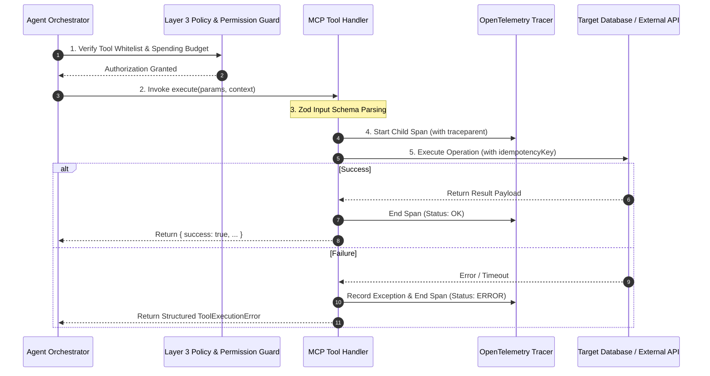

# MCP Tool Authoring & Idempotency Standards `[🧑 HUMAN]`

> **Audience:** `🧑 Human / Builder` &nbsp;|&nbsp; **Classification:** Developer Standard & Runtime Contract &nbsp;|&nbsp; **Compliance:** Mandatory for all Tool Armory tools

---

## 1. Tool Lifecycle & Architectural Invariants `[🧑 Human]`

Every Model Context Protocol (MCP) tool registered in Oddjob operates within a governed, traced execution container:



### The 4 Foundational Rules:
1. **Strict Zod Input Validation:** Never use `z.any()` or loose untyped strings. Every parameter must have `.describe()`, explicit length bounds, and valid regex constraints.
2. **Context Injection:** Tools receive an ambient `ToolContext` containing `organizationId`, `userId`, `traceparent`, and `logger`. Never rely on global state.
3. **Deterministic Idempotency on Mutations:** Any tool performing a `CREATE`, `UPDATE`, or `DELETE` mutation MUST accept `idempotencyKey?: string`.
4. **Structured Error Codes:** Never throw raw uncaught exceptions. Return structured error payloads with standard machine-parseable error codes.

---

## 2. Standard Tool Context Interface `[🤖 Agent Reference]`

```typescript
export interface ToolContext {
  organizationId: number;
  userId?: string;
  traceparent?: string;
  missionId?: number;
  idempotencyKey?: string;
  logger: {
    info: (msg: string, meta?: Record<string, unknown>) => void;
    warn: (msg: string, meta?: Record<string, unknown>) => void;
    error: (msg: string, meta?: Record<string, unknown>) => void;
  };
}
```

---

## 3. Reference Implementation: Safe Read-Only Tool `[🧑 Human]`

```typescript
import { z } from "zod";
import { type McpToolDefinition } from "@server/mcp/types";
import { db } from "@server/db";
import { eq, and } from "drizzle-orm";
import { customers } from "@shared/schema";

export const getCustomerProfileTool: McpToolDefinition = {
  name: "get_customer_profile",
  description: "Retrieves verified customer contact information, account tier, and active billing status.",
  parameters: z.object({
    customerId: z.string().regex(/^cust_[a-z0-9]+$/).describe("Canonical customer ID (e.g. cust_98f4a)"),
    includeBillingDetails: z.boolean().default(false).describe("Whether to include sensitive payment method summaries")
  }),
  execute: async ({ customerId, includeBillingDetails }, context) => {
    context.logger.info(`Fetching customer profile for ${customerId}`);

    const customer = await db.query.customers.findFirst({
      where: and(
        eq(customers.id, customerId),
        eq(customers.organizationId, context.organizationId)
      )
    });

    if (!customer) {
      return {
        success: false,
        errorCode: "CUSTOMER_NOT_FOUND",
        message: `Customer ${customerId} does not exist in organization ${context.organizationId}.`
      };
    }

    return {
      success: true,
      data: {
        id: customer.id,
        name: customer.name,
        email: customer.email,
        tier: customer.tier,
        billingStatus: customer.billingStatus,
        ...(includeBillingDetails ? { billingSummary: customer.billingSummary } : {})
      }
    };
  }
};
```

---

## 4. Reference Implementation: Mutating Tool with Two-Phase Commit & Rollback `[🧑 Human]`

```typescript
import { z } from "zod";
import { type McpToolDefinition } from "@server/mcp/types";
import { db } from "@server/db";
import { invoices, invoiceJournal } from "@shared/schema";
import { eq } from "drizzle-orm";

export const createInvoiceWithRollbackTool: McpToolDefinition = {
  name: "create_customer_invoice",
  description: "Generates a legal customer invoice with guaranteed idempotency and compensating rollback support.",
  parameters: z.object({
    customerId: z.string().regex(/^cust_[a-z0-9]+$/).describe("Target customer ID"),
    amountCents: z.number().int().positive().describe("Invoice total in USD cents"),
    description: z.string().min(5).max(255).describe("Line item explanation"),
    idempotencyKey: z.string().uuid().describe("Deterministic UUID to prevent duplicate billing")
  }),
  execute: async ({ customerId, amountCents, description, idempotencyKey }, context) => {
    // 1. Check idempotency journal
    const existing = await db.query.invoiceJournal.findFirst({
      where: eq(invoiceJournal.idempotencyKey, idempotencyKey)
    });

    if (existing) {
      context.logger.warn(`Idempotent hit for key ${idempotencyKey}`);
      return {
        success: true,
        isIdempotentReplay: true,
        invoiceId: existing.invoiceId,
        status: existing.status
      };
    }

    // 2. Perform transactional write
    return await db.transaction(async (tx) => {
      const [newInvoice] = await tx.insert(invoices).values({
        organizationId: context.organizationId,
        customerId,
        amountCents,
        description,
        status: "ISSUED",
        createdAt: new Date()
      }).returning();

      await tx.insert(invoiceJournal).values({
        idempotencyKey,
        invoiceId: newInvoice.id,
        status: "COMMITTED",
        organizationId: context.organizationId,
        createdAt: new Date()
      });

      return {
        success: true,
        invoiceId: newInvoice.id,
        status: "COMMITTED",
        rollbackTool: "void_customer_invoice",
        rollbackPayload: { invoiceId: newInvoice.id, reason: "AGENT_COMPENSATION" }
      };
    });
  }
};
```

---

## 5. Automated Testing Pattern (Vitest) `[🧑 Human]`

Always author a corresponding test file under `tests/unit/tools/`:

```typescript
import { describe, it, expect, vi } from "vitest";
import { getCustomerProfileTool } from "./customer-tools";

describe("getCustomerProfileTool", () => {
  it("rejects malformed customer IDs via Zod validation", async () => {
    const invalidParams = { customerId: "INVALID_ID!" };
    const parseResult = getCustomerProfileTool.parameters.safeParse(invalidParams);
    expect(parseResult.success).toBe(false);
  });

  it("successfully parses valid customer IDs", async () => {
    const validParams = { customerId: "cust_94812", includeBillingDetails: true };
    const parseResult = getCustomerProfileTool.parameters.safeParse(validParams);
    expect(parseResult.success).toBe(true);
  });
});
```
