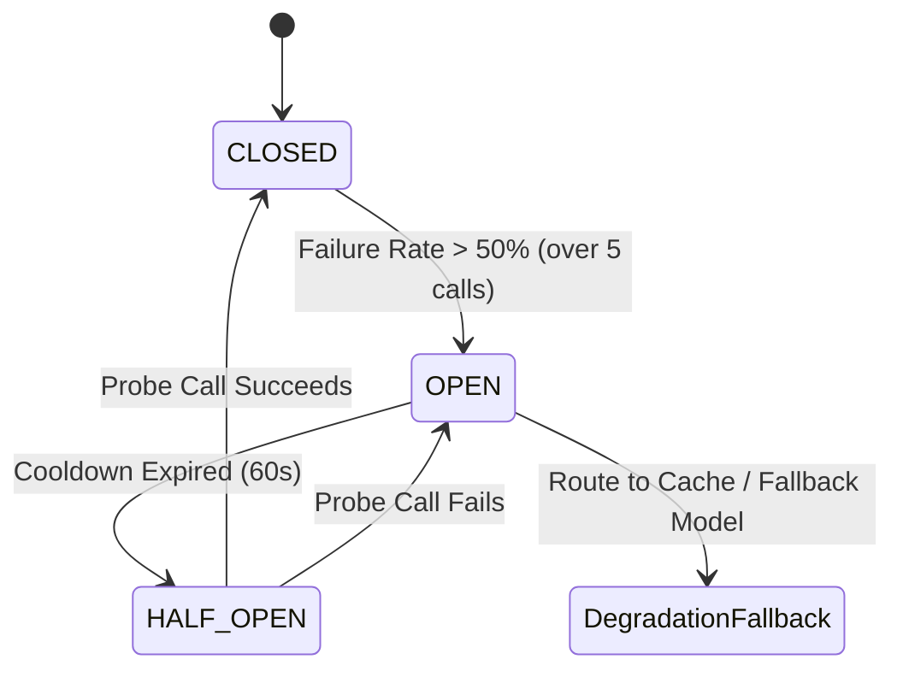
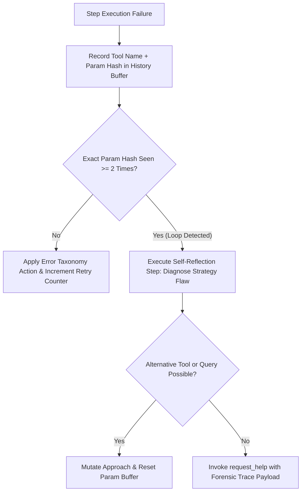

# Autonomous Agent Error Recovery & Circuit Breakers `[🤖 AGENT]`

> **Audience:** `🤖 Agent Executable & Runtime SRE` &nbsp;|&nbsp; **Classification:** Runtime Operational Runbook

---

## 1. The 3-State Circuit Breaker Lifecycle `[🧑 Human]`

When interacting with external APIs, databases, or MCP tools, agents must never bombard failing services. Oddjob enforces a deterministic 3-state Circuit Breaker:



| State | Execution Policy | Next Transition |
| :--- | :--- | :--- |
| **`CLOSED`** (Normal) | All tool invocations execute directly. Track failure metrics in sliding 60s window. | Transitions to `OPEN` if failure rate $\ge 50\%$ over $\ge 5$ requests. |
| **`OPEN`** (Tripped) | Invocations immediately fast-fail with `ERR_CIRCUIT_BREAKER_OPEN`. Agent must activate local fallback or cached state. | Transitions to `HALF_OPEN` after $60\text{ seconds}$ cooldown timer. |
| **`HALF_OPEN`** (Probing) | Exactly 1 probe request is permitted through to test downstream health. | If probe succeeds $\rightarrow$ `CLOSED`. If probe fails $\rightarrow$ `OPEN` with exponential cooldown ($120\text{s}$). |

---

## 2. Oddjob Error Code Taxonomy & Resolution Matrix `[🤖 Agent Reference]`

When a tool or API returns an error payload, inspect the structured `errorCode` and execute the mandatory resolution protocol:

| Error Code | Root Cause | Immediate Agent Recovery Action | Max Retries |
| :--- | :--- | :--- | :--- |
| **`ERR_RATE_LIMIT_429`** | Upstream API saturation | Apply Full Jitter Exponential Backoff: $T = \min(60, 2^{\text{attempt}} \times 1.0) + \text{rand}(0, 1)$. | 3 |
| **`ERR_SCHEMA_VALIDATION`** | Malformed JSON tool input | Inspect Zod error path, review tool definition, and regenerate strictly validated arguments. | 1 |
| **`ERR_TOOL_NOT_FOUND`** | Hallucinated tool identifier | Invoke `discover_capabilities({ query: "..." })` to resolve correct active tool name. | 1 |
| **`ERR_TIMEOUT_504`** | Downstream latency spike | Halve batch size or narrow query filter scope; retry with increased timeout budget. | 2 |
| **`ERR_PERMISSION_DENIED`** | RBAC boundary or budget cap | Abort immediate mutation; trigger `request_help` / HIL permission grant modal. | 0 (No retry) |
| **`ERR_CIRCUIT_BREAKER_OPEN`** | Target service unavailable | Switch to secondary provider / read-only local replica; flag degraded operational state. | 0 (Immediate fallback) |

---

## 3. Autonomous Self-Correction & Loop Detection Algorithm `[🤖 Agent Reference]`

To prevent infinite thrashing loops (e.g. repeated failing search queries):



### Self-Correction TypeScript Protocol

```typescript
export interface ErrorRecoveryContext {
  subtaskId: string;
  attempt: number;
  maxAttempts: number;
  historyBuffer: Array<{ toolName: string; paramHash: string; errorCode: string }>;
}

export function evaluateErrorRecovery(
  error: { code: string; message: string },
  toolName: string,
  params: Record<string, any>,
  ctx: ErrorRecoveryContext
): { action: "RETRY" | "FALLBACK" | "ESCALATE"; delayMs?: number; fallbackTool?: string } {
  const paramHash = JSON.stringify(params);
  const repeated = ctx.historyBuffer.filter(h => h.toolName === toolName && h.paramHash === paramHash).length;

  if (repeated >= 2 || ctx.attempt >= ctx.maxAttempts) {
    return { action: "ESCALATE" };
  }

  if (error.code === "ERR_RATE_LIMIT_429") {
    const delayMs = Math.min(60000, Math.pow(2, ctx.attempt) * 1000) + Math.random() * 1000;
    return { action: "RETRY", delayMs };
  }

  if (error.code === "ERR_TOOL_NOT_FOUND") {
    return { action: "FALLBACK", fallbackTool: "discover_capabilities" };
  }

  return { action: "ESCALATE" };
}
```

---

## 4. Post-Recovery Telemetry Contract `[🧑 Human]`

Upon successful error recovery:
1. Record an `AgentRecoverySuccess` OpenTelemetry event with recovery duration and strategy used.
2. If circuit breaker tripped, emit a degraded-mode metric to the Admin Health Dashboard.
