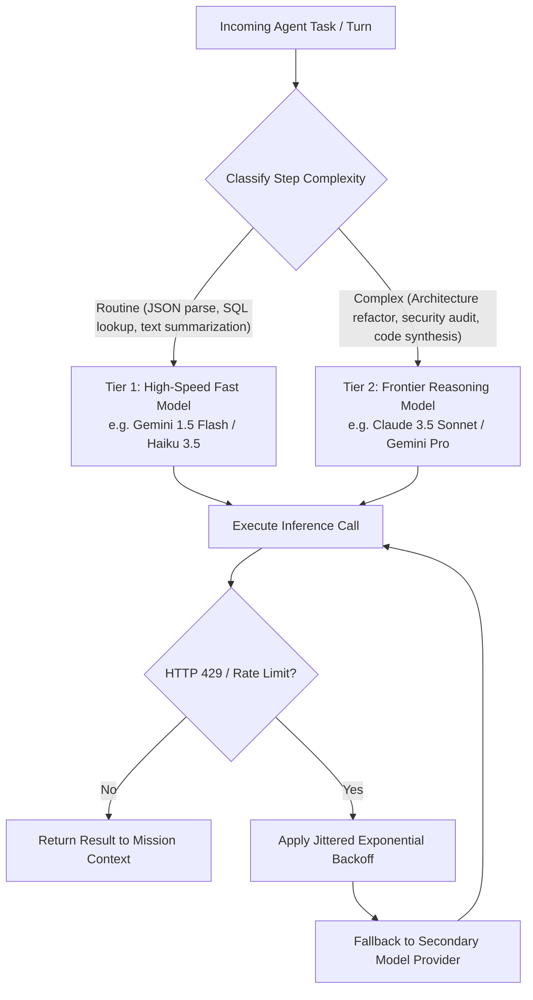

# Agent Rate-Limiting & Model Tier Fallback

> **Audience:** 🤖 Agent / Autonomous | 🛡️ Safety & Governance | 🧑 Human / Builder  
> **Autonomy Level:** L2 to L5  
> **Telemetry Span:** `model.budget.evaluate`

---

## 1. Multi-Tier Model Routing Strategy

Not every agent turn requires an expensive reasoning model (e.g. Claude 3.5 Sonnet / o1 / Gemini 1.5 Pro). Oddjob enforces dynamic model routing based on task complexity:



---

## 2. Rate-Limiting & Jittered Backoff Algorithm

When an upstream LLM API returns `HTTP 429 (Too Many Requests)`:

$$\text{Delay}(n) = \min\left(\text{MaxDelay}, \text{BaseDelay} \times 2^n\right) \pm \text{Uniform}(0, \text{Jitter})$$

```typescript
export async function executeWithRateLimitRetry<T>(
  modelCall: () => Promise<T>,
  maxRetries: number = 3,
  baseDelayMs: number = 1000,
  maxDelayMs: number = 10000
): Promise<T> {
  let attempt = 0;

  while (attempt <= maxRetries) {
    try {
      return await modelCall();
    } catch (err: any) {
      attempt++;
      const isRateLimit = err.status === 429 || /rate limit|quota exceeded/i.test(err.message);

      if (!isRateLimit || attempt > maxRetries) {
        throw err;
      }

      // Calculate exponential backoff with random jitter
      const exponential = Math.min(maxDelayMs, baseDelayMs * Math.pow(2, attempt));
      const jitter = Math.random() * 500;
      const delayMs = exponential + jitter;

      console.warn(`[RATE_LIMIT] Model API returned 429. Backing off for ${Math.round(delayMs)}ms (Attempt ${attempt}/${maxRetries})...`);
      await new Promise((resolve) => setTimeout(resolve, delayMs));
    }
  }

  throw new Error("Exhausted all model retry attempts.");
}
```

---

## 3. Tenant Daily Budget Guardrails

Every organization has an active compute budget cap in the database:

| Metric | Soft Ceiling (80%) | Hard Ceiling (100%) | Action on Breach |
| :--- | :--- | :--- | :--- |
| **Daily Token Spend** | $2,000,000$ tokens | $2,500,000$ tokens | Force downgrade to Flash tier; notify Org Admin |
| **Concurrent Workers** | 8 workers | 10 workers | Queue non-critical missions in Redis buffer |
| **Monthly Budget** | $\$500.00$ | $\$600.00$ | Pause autonomous L4/L5 missions; require human authorization |

---

## 4. Invariants

1. **Deterministic Retry Headers:** Check `retry-after` header in HTTP 429 responses if provided by upstream provider.
2. **Provider Failover Order:** Primary Provider (Gemini) $\to$ Secondary Provider (Anthropic) $\to$ Local Fallback (Ollama / vLLM).
3. **Usage Accounting:** Every token consumed is recorded in `organization_usage_ledger` with its associated `missionRunId`.
