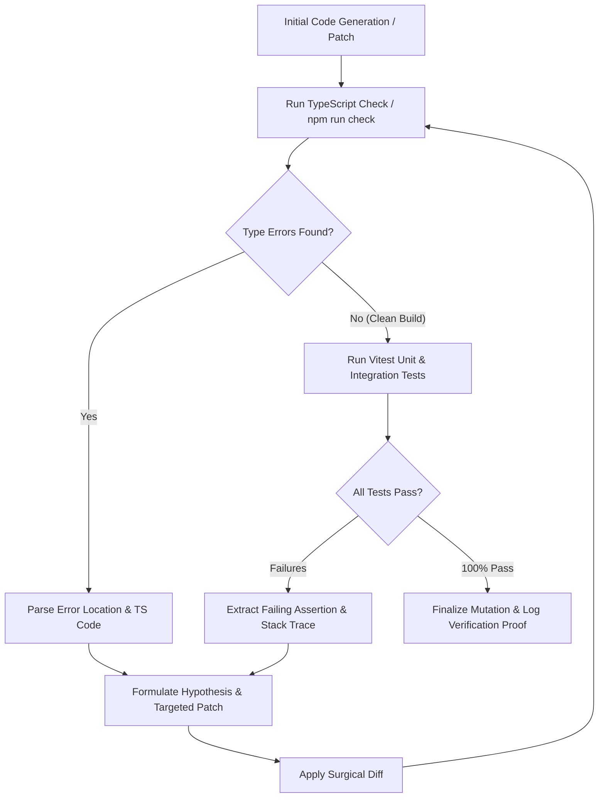

# Agent Self-Reflection & Test-Driven Verification

> **Audience:** 🤖 Agent / Autonomous | 🤝 Hybrid / Co-Pilot  
> **Autonomy Level:** L3 to L5  
> **Telemetry Span:** `agent.reflection.cycle`

---

## 1. The Autonomous Reflection Lifecycle

When an autonomous agent modifies application code or implements a new capability, it must never assume first-pass correctness. It must execute an internal **Reflect & Verify Loop**:



---

## 2. Loop-Breaker Invariants

To avoid infinite loops where an agent flips back and forth between two invalid implementations:

| Condition | Action | Escalation |
| :--- | :--- | :--- |
| **Same Error Repeated Twice** | Abort current strategy; search Knowledge Garden for alternative design patterns | `STRATEGY_PIVOT` |
| **Total Iteration Count $\ge 4$** | Terminate autonomous retry loop; capture full diff | `ESCALATE_TO_HIL` |
| **Regression in Previously Passing Test** | Revert latest patch immediately; re-run baseline | `AUTO_ROLLBACK` |

---

## 3. Structured Self-Reflection Prompt Format

When an error occurs, the agent must output a structured reflection block before making tool calls:

```xml
<reflection_block>
  <error_summary>
    TypeScript Error TS2345: Argument of type 'string' is not assignable to parameter of type 'number'.
    File: server/domain/admin/best-practices.service.ts, Line: 42
  </error_summary>
  
  <root_cause_analysis>
    The function 'getDocsDir' expected an organizationId parameter of type number, but received a raw query string from the Express req.query object.
  </root_cause_analysis>
  
  <proposed_fix>
    Cast 'req.query.orgId' with 'Number(req.query.orgId)' and validate with 'Number.isFinite()' before passing to the service.
  </proposed_fix>
  
  <verification_step>
    Re-run 'npm run check' and execute 'tests/admin/best-practices.test.ts'.
  </verification_step>
</reflection_block>
```

---

## 4. Operational Invariants

1. **Surgical Diffs Only:** Never rewrite an entire 500-line file when fixing a single function or import; use targeted line replacements (`replace_file_content`).
2. **Preserve Surrounding Comments:** Do not delete existing JSDoc comments or type annotations during refactoring.
3. **Log Proof of Passing Tests:** Every pull request or mission completion report must attach the terminal exit code `0` and test summary.
