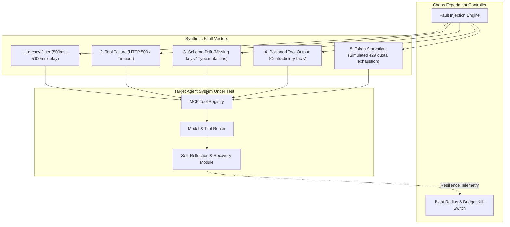

# Agentic Chaos Engineering & Fault Injection Runbook `[⚖️ GOVERNANCE]`

> **Audience:** `⚖️ Governance / SRE & Chaos Engineer` &nbsp;|&nbsp; **Classification:** Runtime Operational Runbook

---

## 1. Chaos Engineering Framework Overview `[🧑 Human]`

AI agents operate in unpredictable runtime environments. The Chaos Engine systematically injects controlled perturbations to verify self-healing and graceful degradation:

---

## 2. Standard Chaos Perturbation Vectors `[🤖 Agent Reference]`

| Fault Vector | Injection Mechanism | Expected Agent Behavior | Verification Standard |
| :--- | :--- | :--- | :--- |
| **Tool Outage** | Force target MCP tool to return `HTTP 503 Service Unavailable`. | Agent detects failure, checks tool alternative, or reports degraded status. | Never loops infinitely; fails within $\le 3$ retries. |
| **Poisoned Output** | Return syntactically valid JSON with false/contradictory data. | Critic agent detects anomaly against Knowledge Graph grounding. | Flags evidence mismatch and prompts user. |
| **Network Latency** | Add $3,000\text{ms}$ delay to API response. | Agent respects timeout limits and avoids hanging UI locks. | Emits latency warning span. |
| **Token Starvation** | Simulate API 429 quota error from LLM provider. | Dynamic router falls back to local 8B / Tier 2 fallback model. | Successfully completes task with fallback tier. |

---

## 3. The Agent Resilience Score (ARS) `[🧑 Human]`

At the conclusion of a chaos run, the system calculates the **Agent Resilience Score (ARS)**:

$$\text{ARS} = \left( 0.4 \times \frac{N_{\text{recovered}}}{N_{\text{injected}}} + 0.3 \times \frac{T_{\text{baseline}}}{T_{\text{degraded}}} + 0.3 \times S_{\text{accuracy}} \right) \times 100$$

- **Target Threshold:** Production agent pipelines must maintain $\text{ARS} \ge 85.0\%$.
- **Critical Failure:** Any uncaught fatal exception drops ARS to `0.0%` and blocks deployment.

---

## 4. Emergency Kill-Switch Protocol `[🤖 Agent Reference]`

If an active chaos experiment causes unexpected latency spikes or impacts live workloads:
1. **Immediate Execution**: Call `abortChaosExperiment({ experimentId })`.
2. **State Flush**: Clear all dynamic interceptor middlewares from the MCP Tool Registry.
3. **Audit Log**: Generate post-mortem summary documenting exact fault state and system recovery timing.
