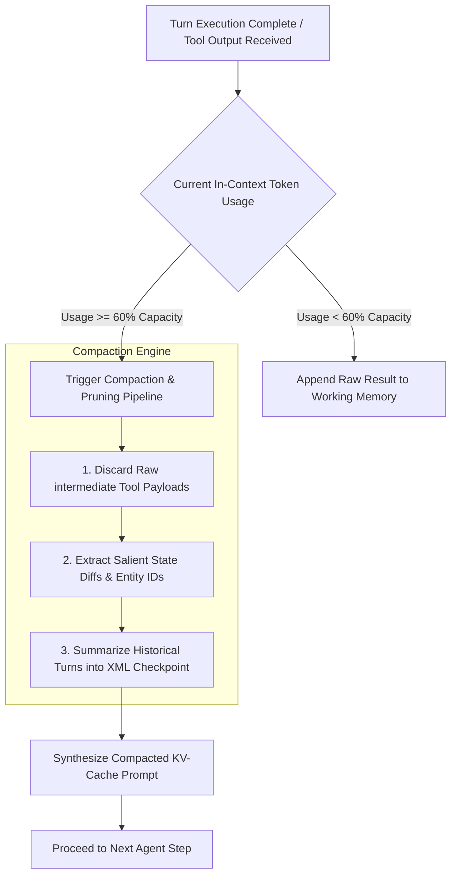

# Context Window Compaction & Semantic Pruning

> **Audience:** 🤖 Agent / Autonomous | 🧑 Human / Builder  
> **Autonomy Level:** L2 to L5  
> **Telemetry Span:** `context.compaction.run`

---

## 1. The Token Budget Degradation Problem

Long-running agent workflows generate massive tool execution logs (e.g. 50-row SQL dumps, raw HTML scrapes, and deep stack traces). Keeping these in working context causes three critical issues:
1. **Lost-in-the-Middle Phenomenon:** LLMs overlook critical system instructions when prompt length exceeds 32k tokens.
2. **Quadratic KV-Cache Costs:** Inference latency and API token spend grow significantly.
3. **Context Overflow Crashes:** Hitting hard token limits abruptly aborts missions.



---

## 2. Pruning & Compaction Algorithm

```typescript
export interface CompactionResult {
  compactedPrompt: string;
  originalTokens: number;
  compactedTokens: number;
  tokensSaved: number;
}

export function compactAgentHistory(
  conversationTurns: Array<{ role: string; content: string; toolCalls?: unknown[] }>,
  maxRetentionTurns: number = 3
): CompactionResult {
  const olderTurns = conversationTurns.slice(0, -maxRetentionTurns);
  const recentTurns = conversationTurns.slice(-maxRetentionTurns);

  // 1. Extract Key Decisions & Entity IDs from older turns
  const extractedEntities = new Set<string>();
  const decisionLog: string[] = [];

  for (const turn of olderTurns) {
    // Extract entity IDs (e.g. #inv_123, Org: 342, Task: 483)
    const entityMatches = turn.content.match(/([a-zA-Z0-9_-]+_[0-9a-f]{6,}|#\d+|Org:\s*\d+)/g) || [];
    entityMatches.forEach((e) => extractedEntities.add(e));

    if (turn.content.includes("✅") || turn.content.includes("DECISION:")) {
      decisionLog.push(turn.content.slice(0, 150));
    }
  }

  // 2. Build Structural XML Checkpoint
  const checkpointBlock = `
<compacted_history_checkpoint>
  <summary>Compressed ${olderTurns.length} earlier operational steps.</summary>
  <retained_entity_anchors>${Array.from(extractedEntities).join(", ")}</retained_entity_anchors>
  <key_milestones>
${decisionLog.map((d) => `    - ${d}`).join("\n")}
  </key_milestones>
</compacted_history_checkpoint>`.trim();

  // 3. Reconstruct working memory
  const finalContext = [checkpointBlock, ...recentTurns.map((t) => `${t.role}: ${t.content}`)].join("\n\n");

  const originalLength = conversationTurns.reduce((acc, t) => acc + t.content.length, 0);
  return {
    compactedPrompt: finalContext,
    originalTokens: Math.ceil(originalLength / 4),
    compactedTokens: Math.ceil(finalContext.length / 4),
    tokensSaved: Math.ceil((originalLength - finalContext.length) / 4),
  };
}
```

---

## 3. Pruning Rules Table

| Content Type | Raw Payload Size | Pruning Action | Compacted Output |
| :--- | :--- | :--- | :--- |
| **SQL SELECT Output** | 50 rows / 15 KB | Keep row count & primary IDs | `"Fetched 50 rows. IDs: [101..150]. Schema valid."` |
| **HTML Web Scrape** | 100 KB HTML | Strip DOM, keep Markdown text | Extracted article markdown ($< 5\text{ KB}$) |
| **Test Suite Run** | 500 lines test logs | Strip passing logs, keep failures | `"18/20 passed. 2 failures in auth.test.ts:42"` |
| **JSON API Response** | 2,000 lines JSON | Extract matching target object | Extracted sub-object ($< 200\text{ bytes}$) |

---

## 4. Invariants

1. **Never Compact System Prompt:** The foundational `<identity>` and `<governance_constraints>` blocks must remain immutable at turn index 0.
2. **Anchor Token Preservation:** Entity IDs, file paths, and transaction keys must never be pruned.
