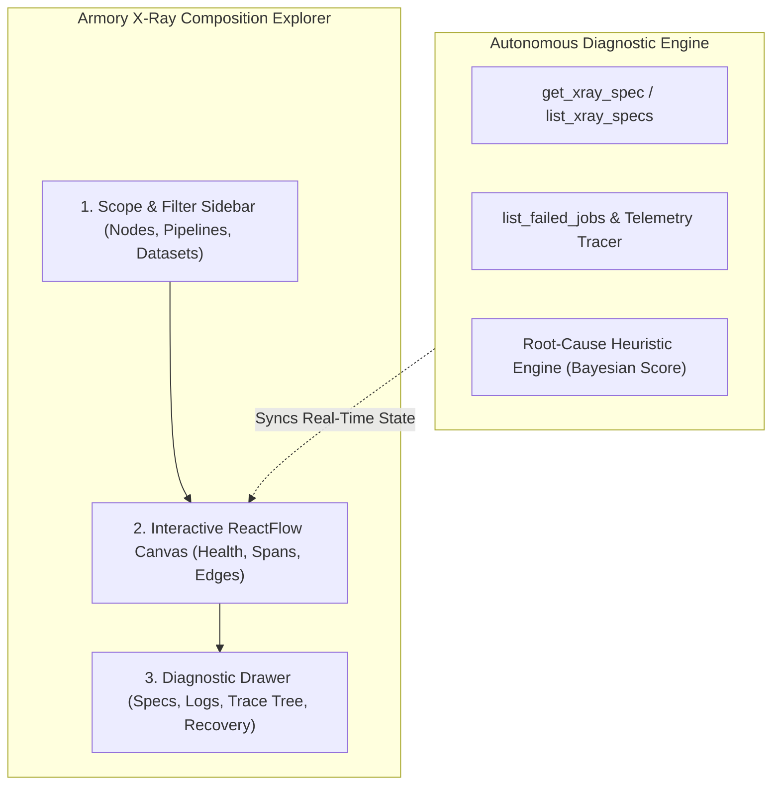
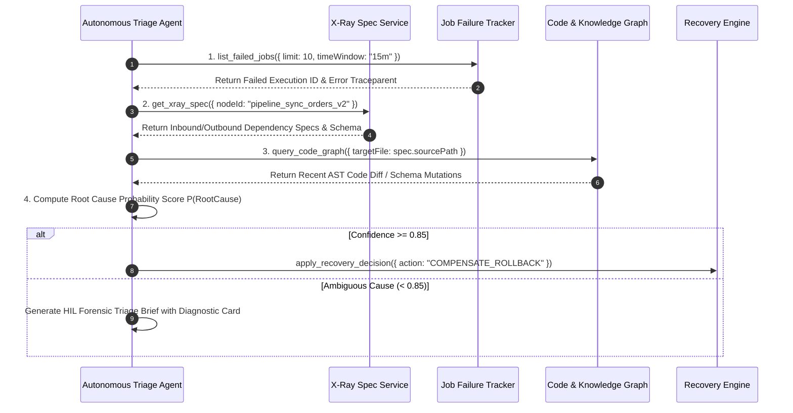

# Armory X-Ray & Autonomous Incident Triage Playbook `[🤝 HYBRID]`

> **Audience:** `🤝 Hybrid: Systems Engineers + Autonomous Diagnostics Agents` &nbsp;|&nbsp; **Classification:** Incident Triage & Forensic Runbook

---

## 1. X-Ray Architecture & Canvas Topology `[🧑 Human]`

The **Armory X-Ray Explorer** (`/armory/x-ray`) provides real-time visualization of Oddjob's live dependency graph across all system layers:



---

## 2. Autonomous Agent Incident Triage Loop `[🤖 Agent Reference]`

When an alert triggers or a mission fails, agents must execute the standard **4-Step Forensic Diagnostic Loop**:



---

## 3. Root-Cause Heuristic Scoring Formula `[🤖 Agent Reference]`

The autonomous diagnostics engine evaluates candidate root causes $C_i$ using weighted Bayesian evidence:

$$P(C_i \mid E) = \frac{P(E \mid C_i) \cdot P(C_i)}{\sum_j P(E \mid C_j) \cdot P(C_j)}$$

### Primary Evidence Weights:
1. **Recent Schema Mutation ($w = 0.40$):** Did upstream table or tool schema change in last 60 minutes?
2. **Upstream Error Spans ($w = 0.35$):** Did parent dependency node emit HTTP 5xx or timeout?
3. **Environment Resource Anomaly ($w = 0.25$):** Did worker host experience memory/CPU saturation?

---

## 4. Remediation & Recovery Tool Signatures `[🤖 Agent Reference]`

### A. Querying Node X-Ray Specification
```typescript
// Querying node spec to inspect topological relationships
const spec = await get_xray_spec({
  nodeId: "calc_net_revenue_v1",
  includeUpstream: true,
  includeDownstream: true
});
```

### B. Applying Automated Recovery Decision
```typescript
// Triggering safe non-destructive recovery
await apply_recovery_decision({
  incidentId: "inc_940182",
  nodeId: "pipeline_sync_orders_v2",
  action: "RESTART_WORKER_WITH_EXPANDED_MEMORY",
  parameters: {
    memoryLimitMb: 2048
  }
});
```
