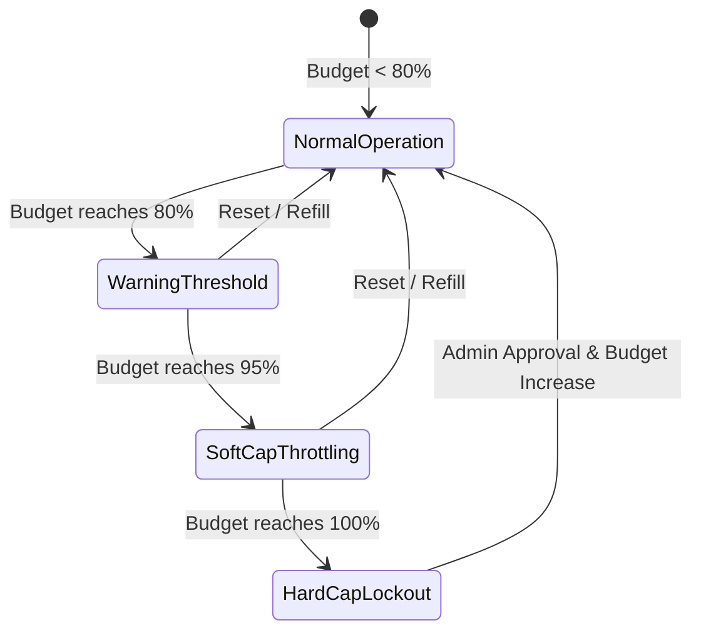

# Dynamic LLM Routing & Cost Arbitrage Standards `[⚖️ GOVERNANCE]`

> **Audience:** `⚖️ Governance / Platform SRE & FinOps` &nbsp;|&nbsp; **Classification:** Runtime Operational Runbook & Cost Policy

---

## 1. 3-Tier Model Hierarchy & Routing Matrix `[🧑 Human]`

Routing every request to a massive frontier model is financially unsustainable. Oddjob dynamically classifies prompt complexity and routes tasks across 3 distinct model tiers:

```mermaid
graph TD
    Prompt["Agent Prompt / Task Request"]

    subgraph Router["Dynamic Complexity & Intent Router"]
        Classifier["Complexity Classifier (Trajectory Score & Token Weight)"]
    end

    subgraph Tier1["Tier 1: Fast / Edge (Local 8B / Flash)"]
        T1Desc["• Token Cost: < $0.0005 / 1k<br/>• Latency: < 200ms<br/>• Tasks: JSON formatting, Entity Extraction, Routing"]
    end

    subgraph Tier2["Tier 2: Mid-Weight (70B / Pro)"]
        T2Desc["• Token Cost: ~ $0.003 / 1k<br/>• Latency: ~ 600ms<br/>• Tasks: Code Refactoring, SQL Generation, Multi-Turn Chat"]
    end

    subgraph Tier3["Tier 3: Frontier Reasoning (Thinking Models)"]
        T3Desc["• Token Cost: ~ $0.02 / 1k<br/>• Latency: ~ 2000ms<br/>• Tasks: System Architecture, Complex Diagnosis, Mathematical Proofs"]
    end

    Prompt --> Router
    Router -->|Low Complexity / T(S) >= 0.85| Tier1
    Router -->|Medium Complexity / T(S) 0.65 - 0.85| Tier2
    Router -->|High Ambiguity / T(S) < 0.65| Tier3
```

---

## 2. Dynamic Trajectory Score Routing Invariant `[🤖 Agent Reference]`

The dynamic router uses the Bayesian Trajectory Score $T(S)$ to determine minimum viable model capability:

$$T(S) = P(\text{Success} \mid S_{t-1}, S_t) \times (1 - \text{BlastRadius}(S))$$

- **$T(S) \ge 0.85$**: Must use **Tier 1** (Small/Local model). Using Tier 3 on routine deterministic tasks is flagged as a cost violation.
- **$0.65 \le T(S) < 0.85$**: Route to **Tier 2** (Mid-tier model).
- **$T(S) < 0.65$ or Critical Production Mutation**: Route to **Tier 3** (Frontier reasoning model).

---

## 3. Spending Cap Enforcement & Degradation States `[🧑 Human]`

Oddjob monitors real-time tenant token burn rate against configured budget tiers:



| Budget State | Token Spend % | Router Behavior | User Experience |
| :--- | :--- | :--- | :--- |
| **Normal** | $0\% - 79\%$ | Optimal performance routing across all tiers. | Instant interactive responses. |
| **Warning** | $80\% - 94\%$ | Emits soft spend warning in Telemetry stream. | Background banner warning. |
| **Soft Throttled** | $95\% - 99\%$ | Tier 3 restricted; all tasks downgraded to Tier 1/2. | Notification of cost conservation mode. |
| **Hard Lockout** | $100\%$ | Agent mutation tools locked. Read-only responses only. | User prompted to increase budget cap. |

---

## 4. Automatic Upstream Failover Matrix `[🤖 Agent Reference]`

If an upstream LLM provider returns `HTTP 429 Rate Limit` or `HTTP 503 Overloaded`:
1. **Instant Fallback**: Switch active provider within **`< 250ms`** without dropping agent context.
2. **Exponential Circuit Breaker**: Mark failing provider unhealthy for 60 seconds; periodically ping with a minimal token heartbeat before restoring primary traffic.
