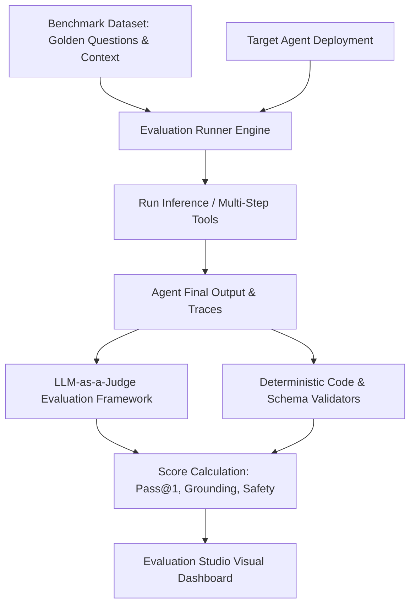

# Evaluation Studio and Benchmark Authoring

## 1. Overview & Architecture

The **Evaluation Studio** (`/admin/evaluation-studio`) provides automated, continuous quality assurance for Oddjob AI agents. It evaluates prompt modifications, tool-calling precision, retrieval grounding, and execution safety across standardized benchmark suites before deploying agent changes to production.



---

## 2. Benchmark Test Case Format

Evaluation suites are defined as structured JSON datasets in the Knowledge Garden. Each test case specifies inputs, expected tool calls, golden assertions, and evaluation criteria:

```json
{
  "testCaseId": "eval-financial-reconciliation-04",
  "name": "QuickBooks vs Stripe Daily Discrepancy Detection",
  "description": "Verifies that the agent correctly identifies a $450 uncaptured refund.",
  "input": {
    "query": "Reconcile yesterday's transactions between Stripe and QuickBooks and highlight any mismatches.",
    "contextDate": "2026-08-25"
  },
  "expectedToolCalls": [
    { "tool": "stripe_get_transactions", "arguments": { "date": "2026-08-25" } },
    { "tool": "quickbooks_get_ledger", "arguments": { "date": "2026-08-25" } }
  ],
  "assertions": {
    "mustContainStrings": ["$450.00", "uncaptured refund", "Discrepancy Detected"],
    "mustNotContainStrings": ["All transactions matched perfectly"],
    "expectedConfidenceScoreGte": 0.85
  }
}
```

---

## 3. Evaluation Metrics & Scoring Rubrics

The Evaluation Studio computes four foundational quality metrics:

1. **Pass@k Accuracy:** The probability that the agent produces a correct, passing solution in $k$ attempts.
2. **Tool Selection Precision:** Precision and recall of appropriate tool invocations without hallucinatory argument values.
3. **Retrieval Grounding (Faithfulness):** Percentage of claims in the generated response that are directly supported by retrieved RAG documents.
4. **Safety & Guardrail Compliance:** Zero tolerance (100% required) for prompt injection susceptibility or unauthorized data leakage.

---

## 4. Running Benchmarks via CLI & CI/CD

Evaluation benchmarks can be triggered automatically during CI/CD pipelines using the platform runner:

```bash
npm run eval:run -- --suite=financial-reconciliation --model=gemini-2.5-pro --concurrency=5
```

---

## 5. Best Practices & Guidelines

1. **Golden Datasets:** Maintain a minimum of 20 diverse, realistic test cases per agent persona.
2. **Edge Case Injection:** Include adversarial prompts, missing parameters, and ambiguous instructions in the test suite to evaluate resilience.
3. **Regression Baselines:** Never promote an agent prompt update to production if its benchmark pass rate drops by more than 2% compared to the existing baseline.
