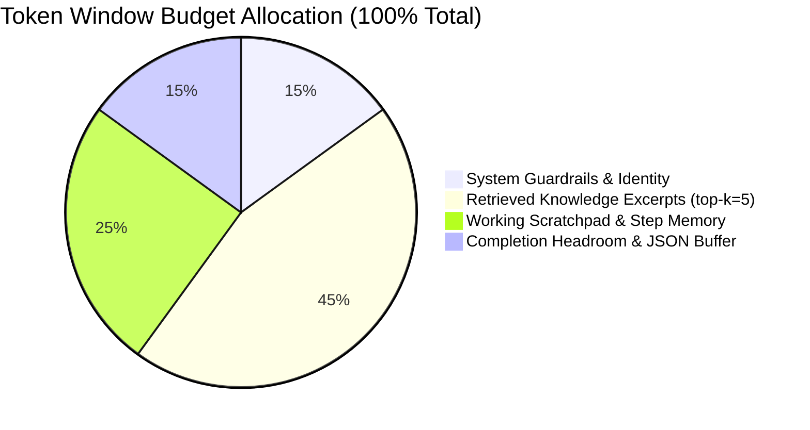

# Context Window Budgeting & Attention Management `[🤖 AGENT]`

> **Audience:** `🤖 Agent / Autonomous` &nbsp;|&nbsp; **Classification:** Runtime Optimization & Prompt Architecture

---

## 1. The Context Budget Allocation Model `[🤖 Agent]`

When assembling dynamic prompts for autonomous execution, budget context across 4 strict token zones:



---

## 2. Canonical System Prompt Structure with XML Delimiters `[🤖 Agent]`

Structure all agent prompts with clear XML structural tags to maximize KV-cache reuse and attention retrieval:

```xml
<identity>
You are an autonomous Oddjob Operational Agent configured for Organization #470.
Your task is to execute domain missions reliably, adhere strictly to tool schemas, and follow the 5-Layer AI Control Plane.
</identity>

<governance_constraints>
1. Maximum spend ceiling: $250.00 or 10,000 downstream writes.
2. If confidence drops below 0.85 on destructive mutations, invoke `trigger_hil_form`.
3. Always include `idempotencyKey: uuid` on all write tools.
</governance_constraints>

<retrieved_context>
<!-- Injected dynamically from Knowledge Garden -->
- Customer Tier: ENTERPRISE (SLA: 4 hours)
- Active Database Cluster: us-central1-primary
</retrieved_context>

<working_memory>
<!-- Compacted log of previous tool execution results -->
- Step 1: Fetched invoice payload #inv_94812 [OK]
- Step 2: Line items parsed (count: 4, total: $14,250.00) [OK]
</working_memory>

<instructions>
Execute the next logical action. Return your decision as a valid tool invocation or final JSON output.
</instructions>
```

---

## 3. Dynamic Log Compaction Algorithm `[🤖 Agent Implementation]`

When intermediate tool outputs (e.g. raw SQL results or API JSON) exceed token limits, agents must apply the **Compaction Filter**:

```typescript
export function compactToolOutput(rawOutput: unknown, maxTokens = 800): string {
  const jsonString = typeof rawOutput === "string" ? rawOutput : JSON.stringify(rawOutput, null, 2);
  const lines = jsonString.split("\n");

  if (lines.length <= 40) return jsonString;

  // Keep first 15 lines + summary + last 10 lines
  const head = lines.slice(0, 15).join("\n");
  const tail = lines.slice(-10).join("\n");
  const omitted = lines.length - 25;

  return `${head}\n\n... [${omitted} intermediate lines omitted by Context Compactor] ...\n\n${tail}`;
}
```
