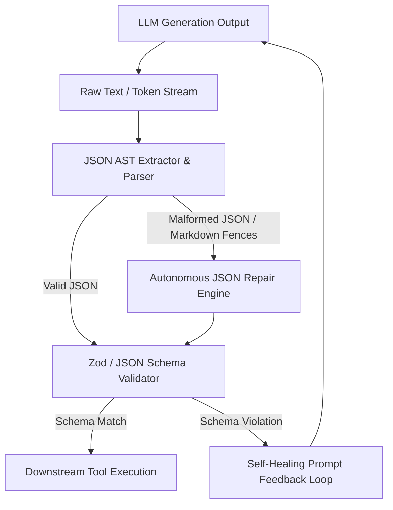

# Structured Output and JSON Schema Enforcement

## 1. Overview & Architecture

Autonomous agent reliability depends fundamentally on predictable, strongly-typed structured outputs. Oddjob utilizes a multi-layer validation and healing pipeline to ensure that all LLM tool calls and response payloads conform strictly to declared JSON Schemas.



---

## 2. JSON AST Extraction & Parsing

Models frequently output JSON wrapped in Markdown code fences (` ```json `), trailing commas, unescaped quotes, or explanatory preamble text. Oddjob's `jsonExtract` utility resolves these common formatting quirks:

1. **Fence Stripping:** Strips leading/trailing Markdown blocks.
2. **Regex Substring Matching:** Finds the outermost balanced brace pair `{ ... }` or bracket pair `[ ... ]`.
3. **Fuzzy Quote Resolution:** Replaces unescaped internal double quotes inside string values.

---

## 3. Zod Schema Enforcement

All agent tool declarations in Oddjob define strict Zod input schemas:

```typescript
import { z } from "zod";

export const TriggerDeploymentSchema = z.object({
  environment: z.enum(["staging", "production"]),
  commitHash: z.string().regex(/^[0-9a-f]{40}$/, "Must be a 40-character git commit SHA"),
  canaryPercentage: z.number().int().min(1).max(100).default(10),
  notificationChannels: z.array(z.string()).default([]),
});

export type TriggerDeploymentInput = z.infer<typeof TriggerDeploymentSchema>;
```

---

## 4. Autonomous Schema Repair & Feedback Loop

When validation fails, Oddjob does not abort the entire mission. Instead, it provides structured error feedback back into the agent context window (max 3 retry iterations):

```json
{
  "status": "schema_error",
  "message": "Validation failed for tool call 'trigger_deployment'",
  "errors": [
    {
      "field": "commitHash",
      "received": "master",
      "expected": "40-character git commit SHA (e.g. 7f3b8a1c...)"
    }
  ],
  "instruction": "Please correct the 'commitHash' argument and retry the tool call."
}
```

---

## 5. Best Practices & Guidelines

1. **Explicit Defaults:** Always supply sensible defaults in the schema for optional fields (e.g., `.default(10)`) to avoid undefined parameter errors.
2. **Descriptions on Fields:** Add `.describe("...")` to every Zod property so the LLM understands the exact semantic purpose and formatting expectations.
3. **Enum Consistency:** Use lowercase string enums to prevent case-sensitivity mismatches during model inference.
