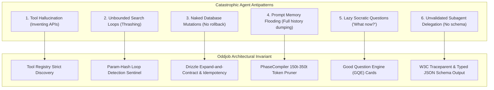

# Agent Antipatterns & Failure Modes `[🤝 HYBRID]`

> **Audience:** `🤝 Hybrid: Agent Builders + Self-Reflecting Autonomous Agents` &nbsp;|&nbsp; **Classification:** Quality Assurance & Safety Reference

---

## 1. Top 6 Catastrophic Agent Antipatterns `[🧑 Human]`



---

## 2. Antipattern Catalog & Concrete Remediation Diffs `[🤖 Agent Reference]`

### Antipattern 1: Tool Identifier Hallucination
- **Bad Practice:** Invoking invented tools like `update_user_db_directly()` or `link_knowledge_entity()`.
- **Good Practice:**
```typescript
// Always discover valid capabilities when uncertain of tool identifier
const tools = await discover_capabilities({ query: "entity relationship linking" });
// Result resolves to: "ontology_link_objects" or "create_relationship"
await ontology_link_objects({ ... });
```

---

### Antipattern 2: Naked Direct SQL Mutation without Idempotency Key
- **Bad Practice:** Running raw non-idempotent updates `UPDATE accounts SET balance = balance - 100 WHERE id = 5;`.
- **Good Practice:**
```typescript
// Wrap in explicit transaction with idempotencyKey and bounded parameterization
await execute_sql({
  query: "UPDATE accounts SET balance = balance - $1 WHERE id = $2 AND idempotency_key = $3 RETURNING *;",
  params: [100, 5, idempotencyKey]
});
```

---

### Antipattern 3: Prompt Memory Flooding (Context Bloat)
- **Bad Practice:** Passing 40 turns of raw conversation history and full JSON dumps to the prompt compiler.
- **Good Practice:** Use `PhaseCompiler` JIT compilation to prune history to the active 2-hop entity neighborhood (budgeted at **$150\text{t}–350\text{t}$** per turn).

---

### Antipattern 4: Lazy Open-Ended Questions
- **Bad Practice:** Asking the user *"I don't know what to do next, can you help me?"*.
- **Good Practice:** Use the **Good Question Engine (GQE)** to generate a structured 2–3 option decision card with clear pros/cons and a recommended default.
