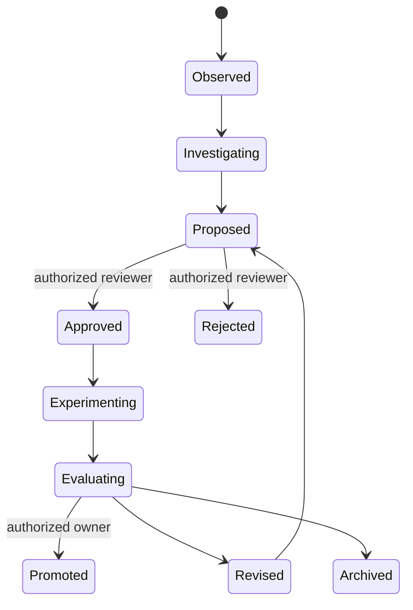
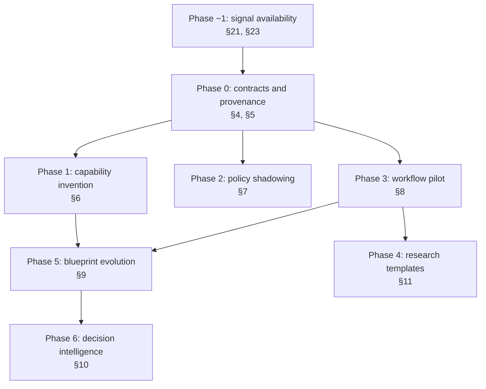

# Evidence-Driven Improvement Loops

## Implementation Specification for Organizational Imagination

**Status:** Proposed  
**Scope:** First production release  
**Last architecture review:** August 25, 2026  
**Implementation audit:** August 25, 2026 against `feat/project-spaces` @ `7487f46b2` (see section 20)  
**Positioning:** A cross-pillar improvement loop over Missions, Forge, Knowledge, Control, and Spatial—not an autonomous strategy or reorganization engine.

## 1. Purpose

Oddjob should turn repeated, observable operational evidence into governed improvement proposals, help operators run bounded experiments, and retain a replayable account of what was learned.

The first release covers three workflows:

1. **Capability invention:** turn repeated execution gaps into reviewed capability proposals and implementation RFCs.
2. **Policy innovation:** identify narrow approval patterns and compare candidate policy decisions in non-authorizing shadow mode.
3. **Internal workflow invention:** analyze an explicitly instrumented workflow, pilot a bounded alternative, and optionally create a Forge draft.

Sections 1 through 19 describe the target system. Sections 20 through 26 record what the codebase actually provides today, correct the assertions in this document that did not survive audit, and define the preconditions for Phase 1. **Read section 20 before scheduling any phase in section 16** — finding F1 blocks Phase 1 as written.

New-service discovery and organizational redesign remain research templates. They are not autonomous product functions in this release because Oddjob does not currently possess reliable demand, workforce, causal-inference, or organizational-health models.

## 2. Product contract

### 2.1 What the system may claim

- A recorded event occurred at a stated time and source.
- A measured duration, count, rate, or distribution was calculated from identified records.
- A proposal was generated from cited observations and declared assumptions.
- An approved experiment ran within its declared cohort, time, budget, and action boundaries.
- A result met or did not meet pre-registered success criteria.
- A human made a recorded promotion, revision, rejection, or archival decision.

### 2.2 What the system must not claim

- An unconnected spreadsheet, email, meeting, or desktop action was observed.
- Correlation establishes why a workflow or organization behaves as observed.
- Frequent approval proves an action is safe.
- Lack of a recorded incident proves lack of harm.
- Synthetic agent scoring proves customer demand or production reliability.
- A Forge build is production-ready merely because code was generated.
- A proposed team structure accounts for capacity, labor rules, incentives, morale, or psychological safety.

### 2.3 Operating rule

Model output may explain, classify, summarize, or propose. Deterministic services must compute metrics, enforce eligibility, compare shadow decisions, assign lifecycle state, and evaluate pre-registered criteria.

## 3. Existing capability baseline

| Existing capability | Evidence available now | Use in this specification | Limitation |
| --- | --- | --- | --- |
| Durable Missions | Mission state, blackboard, dynamic trace, history, deliverables | Execute bounded experiments and preserve evidence | Trace schemas are not uniform enough to infer arbitrary business processes |
| Adaptive and multi-strategy execution | Planned, rolling-wave, parallel, reactive, and human-driven execution | Select a controlled pilot strategy | Estimates and strategy behavior require use-case calibration |
| Resilient Execution | Retry, circuit breaker, healing, escalation | Separate execution faults from hypothesis results | Recovery must never be counted as experimental success |
| Governed Approvals | Approval records, HIL decisions, remediation selection, audit context | Authorize experiments and policy promotion | Approval history alone is not a safety assessment |
| Knowledge Grounding | Documents, RAG, graph context, mission memory | Supply cited context and preserve findings | Source confidence and contradiction handling are still hardening areas |
| CREW | Claims, decisions, alternatives, confidence, commitments | Deliberate over proposals | Consensus is advisory and may reflect shared model bias |
| Capability proposals | Proposal schema, evidence, duplicate candidates, priority service, RFC synthesis | Foundation for capability invention | Current scoring is synthetic and overweights raw evidence count |
| Autoresearch | Shadow mission variants, skill promotion and rollback, tournament workflows | Evaluate bounded skill or strategy variants | Not a general production-safety or market-validation engine |
| App Forge | Planning, generation, validation, deployment proposal | Produce a draft interface for a validated workflow | Product capability is maturing; validation is not proof of operational fitness |
| Prediction and simulation | Prediction runtime, scenario proposal, counterfactual simulator | Advisory scenario comparison | Canonical maturity is experimental; never a promotion authority |
| Good Question Engine | Structured FormAgent questions, lifecycle attestations, divergence questions, blueprint lint remediation cards | Elicit the smallest consequential human judgment needed to reduce uncertainty | Current entropy, discriminative-value, risk, and affected-node fields contain heuristic or placeholder behavior requiring hardening |
| Spatial Signals | H3, geofences, signal ingestion, positional provenance | Optional location segmentation | Unknown or imprecise locations cannot support definite conclusions |
| Blueprint Cycles | Mission DAGs, dependencies, triggers, HIL forms, guardrails, datasets, handoffs, and execution plans | Coordinate invention, evaluation, and promotion workflows | Blueprint orchestration does not itself provide valid measurements, safe mutation, or rollback |
| Pipeline and schedule tools | Admin-scoped add, update, and delete operations for steps, schedules, and scheduled jobs | Apply approved execution changes | Cycle recurrence and pipeline scheduling are separate systems and require separate validation |
| Forge workspace evolution | File editing, natural-language enhancement, builds, validation, releases | Improve operational app surfaces | Direct enhancement can rebuild and restart an app; it requires preview and release governance |
| Self-improvement domain | `server/domain/self-improvement/` — weakness mining, proposal heuristics and validation, auto-patch, failure propagation, harness registry, incident and audit simulators, system graph | Prior art for sections 6 and 12; several services are reused or superseded rather than rebuilt | Pattern identity is model-assigned, its evidence tables carry no tenant column, and `auto-patch` mutates outside the section 9 change-set contract. See findings F4–F7 and the disposition table in section 22 |

Canonical references:

- `shared/product/oddjob-capability-manifest.ts`
- `shared/product/oddjob-executable-capability-manifests.ts`
- `docs/capabilities/CATALOG.md`
- `docs/CAPABILITY_MATURITY_RUBRIC.md`

## 4. Shared domain model

The first release introduces a small evidence-and-experiment domain. It should not reuse mission blackboards as the sole durable record.

### 4.1 `improvement_opportunities`

| Field | Type | Meaning |
| --- | --- | --- |
| `id` | serial | Stable identifier |
| `organization_id` | integer | Mandatory tenant boundary |
| `project_id` | integer, nullable | Optional project boundary |
| `kind` | enum | `capability_gap`, `policy_candidate`, `workflow_candidate` |
| `title` | text | Human-readable description |
| `status` | enum | `observed`, `investigating`, `proposed`, `approved`, `experimenting`, `evaluating`, `promoted`, `revised`, `rejected`, `archived` |
| `source_window_start/end` | timestamp | Evidence observation period |
| `created_by_type/id` | text | User, agent, or service provenance |
| `confidence` | numeric | Confidence in the description, not probability of success |
| `assumptions` | jsonb | Explicit, reviewable assumptions |
| `limitations` | jsonb | Missing sources and inference limits |
| `created_at/updated_at` | timestamp | Audit fields |

### 4.2 `improvement_observations`

Every factual input is an immutable observation.

| Field | Type | Meaning |
| --- | --- | --- |
| `opportunity_id` | integer | Parent opportunity |
| `source_type` | enum | `mission_event`, `tool_failure`, `approval`, `workflow_event`, `incident`, `dataset_record`, `document`, `human_attestation` |
| `source_id` | text | Stable reference to the originating record |
| `observed_at` | timestamp | When the source event occurred |
| `ingested_at` | timestamp | When Oddjob recorded it |
| `facts` | jsonb | Typed, minimally transformed facts |
| `content_hash` | text | Deduplication and tamper evidence |
| `provenance` | jsonb | Route, table, connector, file, or document reference |

An observation may not contain an unsupported causal label such as `caused_delay`. It may contain `wait_duration_ms` or `followed_by_rework`.

### 4.3 `improvement_hypotheses`

| Field | Type | Meaning |
| --- | --- | --- |
| `statement` | text | Falsifiable claim |
| `mechanism` | text | Proposed explanation, explicitly labeled as a hypothesis |
| `supporting_observation_ids` | integer[] | Evidence for the hypothesis |
| `contradicting_observation_ids` | integer[] | Evidence against it |
| `alternatives` | jsonb | Competing explanations or interventions |
| `unknowns` | jsonb | Missing facts required for confidence |
| `author_type/id` | text | Human or agent provenance |

### 4.4 `improvement_experiments`

Required fields before approval:

- hypothesis identifier;
- baseline definition and measurement window;
- intervention and control, if applicable;
- inclusion and exclusion criteria;
- start and end dates;
- maximum cases, budget, and external actions;
- primary metric and direction of improvement;
- guardrail metrics that must not degrade;
- minimum evidence threshold;
- stop and rollback conditions;
- permitted tools, credentials, datasets, and systems;
- required approver role;
- linked mission and optional shadow mission identifiers.

### 4.5 `improvement_results`

Results store computed measurements separately from model interpretation:

- baseline metric value and sample count;
- intervention metric value and sample count;
- missing and excluded record counts with reasons;
- execution-failure count;
- policy-stop count;
- guardrail results;
- deterministic criterion outcome: `passed`, `failed`, `inconclusive`, or `not_run`;
- model-generated interpretation with citations;
- human disposition and rationale.

### 4.6 `improvement_change_sets`

An invention may act only through a versioned, typed change set. Natural-language instructions are supporting context, not the mutation contract.

```ts
interface ImprovementChangeSet {
  id: number;
  opportunityId: number;
  organizationId: number;
  projectId?: number;
  targetType: "cycle_blueprint" | "cycle_schedule" | "pipeline_step" | "forge_app";
  targetId: string;
  expectedVersion: string;
  reason: string;
  evidenceIds: number[];
  operations: ImprovementChangeOperation[];
  validationPlan: Record<string, unknown>;
  rolloutPlan: Record<string, unknown>;
  rollbackPlan: Record<string, unknown>;
  status: "draft" | "validated" | "approved" | "applying" | "applied" | "verified" | "rolled_back" | "failed";
  contentHash: string;
}
```

Supported operations:

- add, update, disable, or remove a cycle blueprint mission;
- update cycle recurrence, timezone, next-run time, limits, or approval configuration;
- add, update, reorder, disable, or remove a pipeline step;
- create or update a schedule or scheduled-job binding;
- edit a Forge draft file or request a generated app enhancement;
- create a Forge release candidate;
- restore a previously verified target version.

Approval binds to `contentHash`. Any modification after approval invalidates the approval and returns the change set to `draft`.

### 4.7 `improvement_prediction_assessments`

Prediction output is retained as a time-stamped advisory artifact so it can later be compared with observed results.

Required fields:

- opportunity, hypothesis, experiment, change-set, and target-version references;
- prediction engine and strategy/plugin versions;
- context and X-Ray fingerprints;
- active, reserved, suppressed, and pruned branches;
- supporting and opposing observation identifiers;
- probability, confidence, entropy, expected value, and risk class when produced;
- caveats, missing-evidence hypotheses, and governance result;
- creation time and provenance;
- later observed outcome and calibration error, without mutating the original prediction.

### 4.8 `improvement_questions`

Every GQE intervention stores:

- prediction-assessment and proposal references;
- uncertainty or decision boundary that triggered the question;
- available options mapped to typed consequences or change-set operations;
- required approver roles;
- answer, answering actor, and answer time;
- resulting hypothesis, experiment, or change-set version;
- superseded question and answer references when the proposal changes.

A GQE answer is structured input. It is not approval unless the answering actor, form, action, and policy independently satisfy the Control approval contract.

## 5. Shared lifecycle and authority



Agents may create observations, hypotheses, drafts, and recommendations. Only authorized humans may:

- approve an experiment;
- expand its scope or budget;
- activate a candidate policy;
- publish or deploy a Forge app;
- promote a new executable capability;
- conclude that an organizational or commercial commitment should be made.

## 6. Capability invention

**Prerequisites:** Phase −1 §21.1 (typed gap emission) and §21.2 (run identity); §23 if any existing evidence table is read; §27.2's three-state contract for the similarity input. **Blocked by:** F1, F2, F9. **Replaces:** `capability-gap-prioritizer.service.ts` (§22).

### 6.1 Observable inputs

Only the following count as gap evidence:

- a recorded `tool_not_found`, `capability_unavailable`, schema rejection, or unreachable dependency;
- a mission step explicitly marked blocked because no permitted capability could satisfy it;
- a human-submitted gap with a concrete attempted outcome;
- a repeated workaround whose tool calls and elapsed time are present in a mission trace.

LLM statements such as “a connector would be useful” do not count as execution failures.

**None of these four inputs is currently emitted as a typed record.** The missing-tool path returns an unclassified string before any telemetry is written, and it conflates a missing capability with a permission denial. See findings F1 and F2; section 21.1 specifies the emitter this workflow depends on.

### 6.2 Normalized gap signature

```ts
interface CapabilityGapSignature {
  intendedOutcome: string;
  targetSystem?: string;
  requiredVerb: string;
  requiredObject: string;
  inputShapeHash?: string;
  permissionScope?: string;
  failureClass: "missing" | "unavailable" | "unauthorized" | "incompatible";
}
```

`unauthorized` gaps must first be reviewed as access or policy problems. They must not automatically generate replacement tools intended to bypass authorization.

### 6.3 Deterministic prioritization v1

Replace the current raw-evidence-count score for this workflow with documented components. v1 is `server/domain/capabilities/core/capability-gap-prioritizer.service.ts`; correction C3 records why its scores cannot be migrated to v2 and why one of its three published components is always zero in production.

```text
frequency_score       = min(unique_affected_runs / 10, 1) * 25
user_impact_score     = min(unique_affected_users / 5, 1) * 15
workaround_cost_score = min(median_workaround_minutes / 60, 1) * 15
strategic_score       = human-assigned 0..15
confidence_score      = evidence_completeness 0..15
duplicate_penalty     = max_similarity >= 0.85 ? 20 : 0
risk_penalty          = unresolved_security_or_authority_question ? 20 : 0

priority = clamp(sum(scores) - penalties, 0, 100)
```

The UI must show every component and underlying counts. `strategic_score` requires a named human scorer.

### 6.4 Execution flow

1. Capture and normalize gap events.
2. Deduplicate by organization, outcome, target, verb, object, and input shape.
3. Search the active and inactive capability registry before proposing new work.
4. Separate missing, unavailable, unauthorized, and incompatible gaps.
5. Rank candidates using the deterministic score.
6. Let an owner merge, dismiss, or approve RFC synthesis.
7. Generate an RFC containing contract, threat model, tests, credentials, tenant boundary, failure behavior, and build-versus-integrate decision.
8. Implement in a sandbox or normal engineering workflow.
9. Run deterministic contract and security tests.
10. Optionally compare skill or strategy variants with Autoresearch.
11. Run a shadow mission using recorded fixtures.
12. Require human promotion into the executable registry.

### 6.5 Acceptance criteria

- Two identical failures in one run count as one affected run.
- A permission denial is never presented as proof of a missing capability.
- Every priority score can be recalculated from displayed records.
- Existing inactive capabilities appear before an RFC option.
- RFC generation performs no registry mutation.
- Autoresearch results are labeled synthetic or fixture-based when applicable.
- Promotion requires deterministic tests and an authorized human decision.

## 7. Policy innovation

**Prerequisites:** §21.3 (active-policy baseline capture, including the predicate-ordering fix); an answer to §26 Q1 on which governor implementation is live. **Blocked by:** C2, F8. **Extends:** `hil-enhancements.service.ts` (§22).

### 7.1 Observable inputs

Use approval request and resolution records, including:

- normalized action type and resource class;
- risk and policy classification;
- exact requested parameters after sensitive-field hashing or redaction;
- decision and decision time;
- applied remediation, if any;
- resolving actor and authority;
- execution status after approval;
- linked rollback, error, incident, or complaint when observable.

The current `hilApprovalPatterns` implementation hashes broad request context and computes approval rate. This is useful evidence but is insufficient for policy promotion because it does not establish parameter equivalence, remediation semantics, or unobserved harm.

`hilApprovalPatterns` is also **not the authorizing surface**. Auto-approval is decided by seven hardcoded predicates in `server/domain/governor/core/decision-router.ts:271-278`, and `governor_policy_rules` is never consulted there. There is consequently no versioned active rule text for section 7.4's promotion packet, and several of those predicates were themselves added on the basis of raw approval frequency — the inference section 2.2 prohibits. Correction C2 sets out the consequences, and section 21.3 defines the baseline capture that section 7.3 requires.

### 7.2 Candidate eligibility

A pattern is eligible for review only when all are true:

- at least 30 independent resolved requests;
- at least 14 days of observation;
- one narrow action and resource class;
- no unresolved critical incident linked to the pattern;
- remediation decisions are analyzed separately from unchanged approvals;
- parameter bounds can be expressed deterministically;
- an owner identifies the intended policy scope.

These defaults are configurable but changes must be audited. Thresholds are governance heuristics, not statistical proof of safety.

### 7.3 Shadow evaluation

Shadow mode never authorizes an action. For each real request:

1. The active policy produces the controlling decision.
2. The candidate policy evaluates the same normalized input.
3. Oddjob stores both decisions, rule versions, reasons, and parameter-bound results.
4. The request continues under the active policy.
5. A later resolver outcome and observable execution result are attached.

Decision comparison classes:

- `agreement_allow`
- `agreement_review`
- `agreement_deny`
- `candidate_less_restrictive`
- `candidate_more_restrictive`
- `not_comparable`

Every `candidate_less_restrictive` case requires individual review before promotion.

### 7.4 Promotion packet

The HIL packet must show:

- active and candidate rule text and version;
- observation and shadow windows;
- request count and unique actor/resource counts;
- decision comparison matrix;
- all less-restrictive cases;
- approvals with remediation as a separate category;
- known incidents and limits of incident linkage;
- estimated review time saved, based on observed decision latency;
- rollback trigger and expiry/review date.

### 7.5 Acceptance criteria

- Shadow evaluation cannot invoke an action handler.
- A remediated approval is never counted as unchanged approval.
- Candidate policy inputs are organization- and project-scoped.
- Rule changes create immutable versions.
- Promotion requires a policy owner and separate authorized approver where configured.
- Activated candidates have a kill switch and scheduled review date.
- Missing outcome telemetry is reported, not treated as a safe outcome.

## 8. Internal workflow invention

**Prerequisites:** Phase 0 contracts; a pilot workflow whose events already exist (§21.4); a running worker fleet for pilot execution. **Blocked by:** nothing — this is the one workflow whose signal is not missing, and it is therefore the safest first pilot.

### 8.1 Instrumentation boundary

Oddjob analyzes only:

- events emitted by Oddjob missions, pipelines, apps, and workbenches;
- records retrieved through explicitly configured connectors;
- uploaded spreadsheets or CSV files;
- human-entered attestations labeled as such.

It does not monitor arbitrary employee desktops, local spreadsheets, inboxes, or meetings.

### 8.2 Canonical workflow event

```ts
interface WorkflowObservationEvent {
  organizationId: number;
  projectId?: number;
  workflowKey: string;
  caseId: string;
  eventId: string;
  eventType: "entered" | "started" | "completed" | "handed_off" | "reopened" | "approved" | "rejected" | "cancelled";
  stepKey: string;
  actorType?: "user" | "agent" | "system";
  actorIdHash?: string;
  occurredAt: string;
  sourceType: "oddjob" | "connector" | "upload" | "attestation";
  sourceReference: string;
  attributes?: Record<string, unknown>;
}
```

Uploaded rows require an explicit column mapping and validation report. Oddjob must retain the original file reference and never silently infer missing timestamps or case identifiers.

### 8.3 Deterministic measurements

For a declared workflow and window, compute:

- case count;
- completion and cancellation rates;
- elapsed and active duration distributions;
- wait time between steps;
- handoff count;
- reopen and rework rates;
- approval count and latency;
- missing-event and invalid-sequence rates;
- variation count by observed step sequence.

Do not label a high-wait step a bottleneck until the UI states the operational definition, such as “top quartile wait time and present in at least 20 completed cases.”

### 8.4 Hypothesis and pilot

CREW may propose alternatives only after the measurement report exists. Each proposal must cite measured facts and list alternative explanations.

A pilot must use one of:

- a sequential pre/post comparison with declared seasonality limitations;
- a concurrent control/intervention cohort assigned by a human-owned rule;
- a shadow workflow that computes suggested routing without changing real work.

Oddjob must not claim randomization unless assignment was actually random and recorded.

Recommended default pilot:

- `rolling_wave` or `human_driven` mission;
- 20-case maximum;
- two-to-four-week time box;
- one primary metric;
- at least two guardrail metrics, including quality or rework;
- no external communication or production mutation outside explicit approval boundaries.

### 8.5 Forge graduation

Passing a pilot may create a Forge **draft proposal** containing:

- workflow states and transitions;
- role and permission assumptions;
- input and output data contracts;
- approval points;
- audit and reporting requirements;
- integration requirements;
- pilot evidence and unresolved limitations.

Forge validation and publication remain separate governed steps. The generated app cannot automatically replace the observed workflow.

### 8.6 Acceptance criteria

- Every metric links to its source window and included record count.
- Missing timestamps or case IDs reduce data-quality coverage and are not imputed silently.
- Human attestations are distinguishable from system events.
- Model-generated hypotheses cite deterministic measurements.
- Execution failure, policy stop, hypothesis failure, and inconclusive evidence are separate outcomes.
- Forge receives a draft only after an authorized evaluation disposition.

## 9. Blueprint evolution and action

**Prerequisites:** at least one upstream workflow producing an approved disposition; a durable blueprint-version table, so `expectedVersion` names something real; the existing dry-run validator at `operational-cycles.ts:1547` extended rather than duplicated (C4). **Depends on:** Control approval records, the mission runtime, and the worker fleet.

> `auto-patch.service.ts` was previously listed here as a prerequisite to fence. It is not one — see the corrected disposition in §22.

Blueprint cycles are the orchestration layer for acting on inventions. Deterministic services establish facts and validate changes; cycle missions coordinate work; HIL grants authority; target-specific tools apply the approved version; verification decides whether to retain or roll back it.

### 9.1 Blueprint portfolio

Implement four blueprint cycles:

1. `improvement-portfolio.cycle.yaml` collects eligible observations, enforces evidence quality, and routes candidates.
2. `capability-invention.cycle.yaml` drives registry search, prioritization, RFC, sandbox, shadow, and promotion.
3. `policy-innovation.cycle.yaml` drives cohort construction, candidate rule creation, non-authorizing shadow evaluation, and scoped promotion.
4. `workflow-invention.cycle.yaml` drives import, measurement, hypothesis review, bounded pilot, evaluation, and optional Forge graduation.

The portfolio cycle may propose or launch an approved child cycle. It may not directly mutate a target.

### 9.2 Blueprint Evolution Cycle

A shared evolution sequence handles all approved structural and surface mutations:

```text
Observe Target
→ Generate Typed Change Set
→ Validate Version, DAG, Policy, Budget, and Dependencies
→ Replay or Shadow Evaluation
→ HIL Selects Exact Alternative
→ Quiesce Target
→ Apply Approved Hash
→ Verify Runtime and Evidence
→ Resume
→ Monitor
→ Promote or Roll Back
```

The HIL decision must distinguish:

- approve the original change;
- apply a named safe remediation;
- request revision;
- reject;
- defer for more evidence.

When a remediation is selected, the applied change set must contain that remediation's operations and hash. The original proposal must not be treated as approved.

### 9.3 Cycle blueprint editing

Current runtime support includes `POST /api/operational-cycles/:id/blueprints/validate` (`server/routes/operational-cycles.ts:1547`), a dry-run validator that the requirements below should extend rather than duplicate, and `PATCH /api/operational-cycles/:id/blueprints` (`:1075`), which replaces the blueprint array, synchronizes relational blueprint rows, rebuilds dependency gates, and recalculates the execution plan. It records up to ten metadata history entries only when a cycle is active or paused.

Production evolution requires:

- a durable blueprint-version table rather than metadata-only history;
- operation-level patches even if the existing endpoint remains the final materializer;
- `expectedVersion` or ETag enforcement to reject stale writes;
- DAG, dependency, trigger, output, HIL, budget, and permission validation before approval;
- semantic and raw diffs;
- source classification: packaged YAML, organization fork, runtime customization, or generated draft;
- explicit reconciliation between `server/cycles/*.cycle.yaml` and database-backed runtime blueprints;
- restoration from a prior verified version.

Removing a mission or gate must fail validation when:

- an active execution is using it;
- another mission consumes its output;
- a dependency references it;
- removal bypasses a required approval, security, compliance, reconciliation, or verification function;
- declared deliverables can no longer be produced.

Conditional narrowing is preferred to deletion when evidence supports only a subset, such as retaining manual review for low-confidence or elevated-risk cases.

### 9.4 Schedule evolution

Cycle scheduling (`recurrence`, `timezone`, `nextRunAt`) and pipeline scheduling (`update_schedule`, `update_scheduled_job`) are separate targets and must not be conflated.

Before applying a schedule change, compute and display:

- current and proposed next run times in the configured timezone;
- expected run-count and cost difference;
- overlap with the target's observed runtime distribution;
- concurrency and backlog risk;
- daylight-saving transitions within the review window;
- activation, expiry, and review dates.

A schedule may first run in forecast-only mode. Deletion or deactivation requires explicit confirmation and must preserve a restorable prior binding.

### 9.5 Pipeline step evolution

Existing admin tools can add, update, and delete pipeline steps. The evolution service must wrap them with:

- upstream and downstream dependency analysis;
- variable and output-consumer validation;
- order and branch reachability checks;
- active-execution checks;
- confirmation for removal;
- a versioned pipeline snapshot;
- post-change dry run or fixture replay;
- rollback to the prior snapshot.

Execution failure after mutation is not evidence that the improvement hypothesis failed. The result must be classified as an application or verification failure.

### 9.6 Forge surface evolution

An approved workflow result may propose app-surface changes using Forge workspace reads, file edits, `studio_enhance_app`, build validation, and release tooling.

The required sequence is:

1. inspect the existing workspace, routes, components, tokens, and data contracts;
2. create a versioned draft or branch;
3. generate file-level diffs;
4. run build, focused interaction, accessibility, and relevant contract tests;
5. render a preview and capture visual evidence;
6. obtain design and operational approval;
7. create a release candidate;
8. publish under the existing Forge release gate;
9. monitor errors and declared usage metrics;
10. roll back to the previous release when a guardrail fires.

Direct `studio_enhance_app` execution is not an acceptable automatic terminal step because it rebuilds and restarts the app. It must be invoked against a preview or governed release candidate.

### 9.7 Approval integrity

Executors must resolve the authoritative approval record at apply time and verify:

- approval identifier and approved `contentHash`;
- organization and project scope;
- approver identity and authority;
- terminal decision and decision timestamp;
- expiry and revocation state;
- selected remediation, when present;
- target version still equals `expectedVersion`.

An approval timestamp embedded in a proposal payload is not authority. Self-modification executors must not construct synthetic super-admin authority from that field.

### 9.8 Live-run semantics

Structural changes default to a quiesced target:

- pending cycles may be edited directly after validation;
- active or running cycles must pause at a safe checkpoint;
- active steps may not be removed or have their contract changed;
- completed steps and their outputs remain immutable for the current run;
- newly added steps must declare whether they apply to the current or next run;
- resume must use persisted state and must not rerun completed work unless explicitly approved;
- failed verification leaves the target paused until rollback succeeds or a human intervenes.

### 9.9 Acceptance criteria

- A blueprint cycle can coordinate an invention without holding direct mutation authority.
- Every mutation references an approved, immutable change-set hash.
- Stale target versions fail before mutation.
- Blueprint and pipeline removal cannot create dangling dependencies or bypass mandatory gates.
- Schedule previews expose overlap, timezone, cost, and run-count effects.
- App enhancements produce a preview and test evidence before release approval.
- Verification failure triggers the declared rollback or pauses for human intervention.
- Packaged YAML and runtime database ownership are visible and never silently overwritten.

## 10. Prediction Intelligence and Good Question Engine

**Prerequisites:** §9 change sets and target versions, so a forecast has a version to bind to; C1 fixed before any question service is extended; real X-Ray node identifiers replacing the placeholder. **Depends on:** `prediction-intelligence/` and `self-improvement/system-graph.service.ts` (§22).

Prediction Intelligence and GQE form a decision-support loop. Prediction exposes plausible outcome branches and uncertainty. GQE converts the most consequential unresolved uncertainty into a bounded human question. CREW interprets the evidence and answer. Control alone authorizes an immutable change set.

### 10.1 Responsibility boundary

| Component | Responsibility | Prohibited authority |
| --- | --- | --- |
| Prediction Intelligence | Generate branches, consequences, evidence, alternatives, entropy, confidence, and calibration records | Approve or execute a mutation |
| Trajectory Prediction Engine | Detect loops, classify transition risk, estimate configured blast radius, and route review | Represent its heuristic score as empirical safety probability |
| GQE | Ask a targeted question and capture structured human input | Treat an answer as broader authority than the resulting typed proposal |
| CREW | Debate observations, predictions, alternatives, and dissent | Convert agent consensus into production authority |
| Control | Authorize an exact proposal or remediated change-set hash | Authorize a different or later version implicitly |
| Blueprint Cycle | Execute, verify, monitor, and roll back inside the approved envelope | Expand scope based on a forecast or room discussion |

### 10.2 Prediction inputs

Every improvement prediction must use a bounded context containing:

- immutable observations and deterministic measurements;
- declared assumptions and missing data;
- current target version and execution state;
- X-Ray nodes, edges, governance gates, data flows, and affected-subgraph fingerprint;
- historical outcomes from comparable experiments, when available;
- permitted action level and applicable policy constraints;
- requested mode: `interactive`, `analysis`, `batch`, or a non-authorizing shadow evaluation.

Prediction may not use organization-wide data merely because it is available. Context permissions and tenant/project boundaries remain authoritative.

### 10.3 Proposal branching

For each eligible invention, Prediction should retain at least:

- the no-change baseline;
- the original proposal;
- one narrower or safer alternative;
- a shadow or evidence-gathering alternative when live action is not justified.

Each branch exposes supporting and opposing evidence, confidence, entropy, expected value when meaningful, affected X-Ray nodes, constraints, and caveats. Pruned branches remain available in the audit record with the pruning reason.

Prediction branches are labeled `forecast`, never `observed fact`. The canonical experimental maturity of Prediction Intelligence must be visible wherever scores are shown.

### 10.4 X-Ray impact prediction

Before CREW recommendation or Control approval, evaluate the proposed X-Ray delta against:

- downstream mission and pipeline consumers;
- trigger and schedule relationships;
- HIL, security, compliance, and verification gates;
- tool, integration, credential, and dataset dependencies;
- active execution position;
- Forge screens, components, APIs, and data contracts;
- expected topology after application.

The current and proposed X-Ray fingerprints bind the prediction to a particular architecture state. A changed target version invalidates the assessment and requires regeneration.

### 10.5 GQE trigger policy

GQE may ask a question when one or more are true:

- branch entropy exceeds a configured and versioned threshold;
- leading branches are too close to distinguish safely;
- forward and reverse analyses disagree;
- supporting and opposing observations conflict;
- a required success metric, guardrail, authority, scope, rollback behavior, or parameter bound is missing;
- an operator attestation contradicts measured evidence;
- predicted blast radius or risk requires a human decision;
- the blueprint linter finds a governance gap, capability deficit, dead end, observability deficit, unbound input/output, or pack conflict.

Configured thresholds are routing heuristics. They must not be presented as scientifically calibrated information gain until real replay evidence supports that claim.

### 10.6 Question quality contract

A production question must:

- name the exact proposal, target, and version;
- state why the answer changes the available action paths;
- show the minimum proof context and relevant uncertainty;
- provide mutually exclusive options where possible;
- include `request more evidence`, `defer`, or equivalent when uncertainty cannot be resolved by preference;
- map every action-bearing option to a typed proposal or change-set version;
- name required approver roles without implying that answering grants approval;
- preserve the selected remediation exactly.

GQE should ask one high-value question at a time rather than presenting a broad questionnaire after the system already has the answer in existing evidence.

### 10.7 CREW Room interaction

The related CREW Room receives:

- current observations and deterministic metrics;
- forecast branches and their evidence;
- actual X-Ray affected-node identifiers;
- uncertainty and contradictions;
- the GQE question and typed options;
- prior answers and proposal versions;
- explicit agent dissent.

The answer creates a revised hypothesis, experiment, or change-set version. Prediction reruns on that version. If the room selects a remediation, approval binds only to the remediated version's hash.

### 10.8 Transition routing

The lightweight trajectory predictor may evaluate improvement lifecycle transitions such as:

```text
Draft → Validate → Request Approval → Apply → Verify → Promote
                                      ↘ Failed Verification → Roll Back
```

It may detect repeated revise/diagnose loops, select an analysis tier, and require review. Critical transitions require human approval regardless of score. `safeTransitionScore`, configured blast radius, and supplied confidence are routing inputs, not observed probabilities.

### 10.9 Pilot monitoring and intervention

During a pilot, Prediction compares incoming observations with registered expectations. Deterministic stop and rollback conditions execute first. GQE is reserved for material decisions not resolved by those rules, such as whether to pause enrollment, investigate, complete the current wave, or roll back.

GQE timeout must not imply approval. A timeout may route to a real isolated shadow sandbox only when it has no mutation-capable credentials or production control; otherwise the proposal remains paused.

### 10.10 Outcome calibration

After evaluation, store predicted and observed values side by side:

- selected and alternative branches;
- forecast confidence and entropy;
- actual primary and guardrail metrics;
- excluded and missing records;
- prediction error and outcome class;
- whether a GQE answer changed the intervention;
- whether the forecast affected the human decision.

Calibration updates future overlays or strategy versions. It never rewrites the original assessment. Until enough comparable outcomes exist, the UI reports sample count and `uncalibrated` status.

### 10.11 Required hardening

Before production authority routing depends on these engines:

- ~~correct `generateStructuredQuestion` so `riskScore` does not contain `safeTransitionScore`~~ — **done** (C1: the two sites used opposite polarities; the derivation is now shared);
- replace the placeholder `2-hop-consumer-node` with actual X-Ray node identifiers;
- distinguish empirical probabilities from configured or model-supplied confidence;
- version entropy and question-trigger thresholds;
- map gap-remediation options to typed immutable operations;
- prevent `Override & Accept Risk` from granting generic authority;
- verify shadow-sandbox isolation rather than returning only a generated run identifier;
- calibrate predictions against real experiment outcomes and disclose sample size;
- retain supporting and opposing evidence with every surfaced forecast.

### 10.12 Acceptance criteria

- Predictions never authorize, mutate, or promote a target.
- Every forecast identifies evidence, target version, X-Ray fingerprint, model/strategy version, and caveats.
- GQE options map to typed outcomes or explicit non-action paths.
- Human answers do not bypass Control approval.
- Critical changes require a human regardless of trajectory score.
- Deterministic stop conditions take precedence over GQE intervention.
- Original predictions remain immutable after observed outcomes arrive.
- Uncalibrated confidence is visibly distinguished from measured reliability.

## 11. Research-only templates

### 11.1 New-service discovery

Allowed output: an evidence packet and customer-research mission containing target segment, observed problem, internal delivery evidence, contradicting evidence, unknowns, interview plan, and human-approved outreach draft.

Not allowed: product-market-fit claims, autonomous customer enrollment, pricing commitments, or demand forecasts presented as established fact.

### 11.2 Organizational redesign

Allowed output: a coordination-delay report and a human-led, time-bounded outcome-cell experiment with affected-participant review.

Not allowed: employee reassignment, reporting-line changes, performance conclusions, workforce optimization, or causal claims derived only from mission telemetry.

## 12. APIs and services

Recommended routes:

```text
GET    /api/improvement/opportunities
POST   /api/improvement/opportunities
GET    /api/improvement/opportunities/:id
POST   /api/improvement/opportunities/:id/observations
POST   /api/improvement/opportunities/:id/hypotheses
POST   /api/improvement/opportunities/:id/experiments
POST   /api/improvement/experiments/:id/approve
POST   /api/improvement/experiments/:id/launch
GET    /api/improvement/experiments/:id/results
POST   /api/improvement/experiments/:id/disposition

GET    /api/improvement/capability-gaps
POST   /api/improvement/capability-gaps/:id/synthesize-rfc

GET    /api/improvement/policy-candidates
POST   /api/improvement/policy-candidates/:id/start-shadow
GET    /api/improvement/policy-candidates/:id/comparison
POST   /api/improvement/policy-candidates/:id/propose-promotion

POST   /api/improvement/workflows/import
GET    /api/improvement/workflows/:key/measurements
POST   /api/improvement/workflows/:key/propose-pilot

POST   /api/improvement/change-sets
GET    /api/improvement/change-sets/:id
POST   /api/improvement/change-sets/:id/validate
POST   /api/improvement/change-sets/:id/request-approval
POST   /api/improvement/change-sets/:id/apply
POST   /api/improvement/change-sets/:id/verify
POST   /api/improvement/change-sets/:id/rollback
GET    /api/improvement/targets/:type/:id/versions

POST   /api/improvement/predictions
GET    /api/improvement/predictions/:id
POST   /api/improvement/predictions/:id/questions
POST   /api/improvement/questions/:id/answer
GET    /api/improvement/predictions/:id/calibration
```

Recommended services:

- `observation-ingestion.service.ts`
- `evidence-provenance.service.ts`
- `capability-gap-normalizer.service.ts`
- `capability-gap-prioritizer-v2.service.ts`
- `policy-pattern-analyzer.service.ts`
- `policy-shadow-evaluator.service.ts`
- `workflow-event-normalizer.service.ts`
- `workflow-measurement.service.ts`
- `experiment-criteria.service.ts`
- `improvement-promotion.service.ts`
- `change-set.service.ts`
- `blueprint-version.service.ts`
- `blueprint-evolution-validator.service.ts`
- `schedule-impact.service.ts`
- `pipeline-impact.service.ts`
- `forge-preview.service.ts`
- `change-approval-integrity.service.ts`
- `change-verification.service.ts`
- `change-rollback.service.ts`
- `improvement-prediction-context.service.ts`
- `improvement-prediction-orchestrator.service.ts`
- `improvement-question-policy.service.ts`
- `improvement-question-resolution.service.ts`
- `prediction-outcome-calibration.service.ts`

This list must be reconciled against `server/domain/self-improvement/` and `server/domain/prediction-intelligence/` before implementation; several entries are extensions or replacements rather than new services. Section 22 gives the disposition for each.

All reads and writes must enforce `organizationId`; project-scoped evidence must additionally enforce `projectId`. Two evidence tables cannot satisfy that rule today — see finding F4 and section 23.

## 13. User experience

The initial surface should be an **Improvement Inbox**, not an autonomous innovation dashboard.

Each card shows:

- candidate type and lifecycle state;
- observation window;
- factual measurements;
- data-quality coverage;
- supporting and contradicting evidence;
- assumptions and unobserved areas;
- proposed next action;
- authority required;
- links to source records and replay evidence.
- exact proposed operations and target version;
- semantic and raw diffs;
- validation, preview, and rollback readiness;
- ownership classification for packaged and runtime blueprints.
- baseline, proposed, safe-alternative, and shadow prediction branches;
- supporting and opposing evidence, uncertainty, calibration status, and GQE questions;

Required decisions:

- investigate;
- merge duplicate;
- dismiss with reason;
- request more evidence;
- approve bounded experiment;
- approve a specific safe remediation;
- promote, revise, or archive after evaluation.
- apply, verify, or roll back an approved change set.

## 14. Security, privacy, and governance

- Default to metadata over employee message content.
- Hash actor identifiers in aggregated workflow analysis unless identity is operationally required and authorized.
- Apply connector permissions at retrieval time; never broaden access through the improvement index.
- Redact credentials, secrets, message bodies, and sensitive parameters before hashing or model use.
- Treat personnel analytics as high-risk and unavailable by default.
- Record model, prompt/template version, deterministic algorithm version, and source hashes for every generated proposal.
- Store authorization decisions independently from mutable proposal text.
- Require explicit retention policy for uploaded spreadsheets and external research data.
- Never infer mutation authority from agent output or an embedded approval timestamp.
- Bind approval to the immutable change-set hash and invalidate it after any edit.
- Require separate release authority for production Forge publication.
- Fail closed when a required evidence or webhook integration is absent; invention cycles must not use the dependency gateway's permissive auto-advance behavior for governance gates.
- Treat Prediction and GQE output as untrusted advisory input to Control.
- Never allow an answer, forecast score, agent consensus, or timeout to manufacture mutation authority.

## 15. Observability

Operational metrics:

- observations accepted, rejected, and deduplicated;
- opportunities by type and state;
- time from observation to human disposition;
- experiments launched, completed, stopped, and inconclusive;
- source-link resolution failures;
- shadow-policy disagreement rate;
- capability gaps resolved by existing capability versus new implementation;
- Forge drafts created and later published;
- manual overrides and rollback activations.
- change sets by target, state, and verification outcome;
- stale-version rejections;
- blueprint, schedule, step, and app rollbacks;
- time spent paused while applying or recovering a change;
- predictions, branches, questions, answers, and recalculations by proposal;
- prediction error, calibration sample count, and uncalibrated forecast rate;
- question deferral, timeout, revision, and answer-to-change rates;

Trust metrics:

- percentage of factual claims with observation references;
- percentage of opportunities exposing contradicting evidence;
- data-quality coverage per workflow report;
- percentage of results with pre-registered criteria;
- rate of human rejection due to unsupported inference;
- rate of missing post-action outcome telemetry.

## 16. Delivery plan

### Phase −1 — signal availability (blocking)

- Emit typed capability-gap events with a mechanical `failureClass` (section 21.1).
- Carry run identity so section 6.5's per-run deduplication is computable (section 21.2).
- Capture the active auto-approve decision and its deciding predicate (section 21.3).
- Add tenant columns to the two unscoped evidence tables and correct the two `serial` score columns (section 23).

Phases 1 and 2 have no inputs until this lands. Section 27.4 gives the full phase dependency graph, and §27.5 lists the ordering constraints that graph does not show.

### Phase 0 — contracts and provenance

- Add shared schemas, lifecycle validation, and tenant boundaries.
- Implement immutable observations and source resolution.
- Add deterministic result and criterion types.
- Test that agents cannot directly approve or promote.

### Phase 1 — capability invention

- Normalize real tool and mission gap events.
- Add registry-first duplicate resolution.
- Implement transparent prioritization v2.
- Adapt the existing RFC synthesizer.
- Add sandbox, fixture, and promotion gates.

### Phase 2 — policy shadowing

- Normalize approval actions and applied remediations.
- Implement candidate eligibility and versioned rules.
- Add a side-effect-free shadow evaluator.
- Build decision comparison and promotion packets.
- Add activation kill switch and scheduled review.

### Phase 3 — workflow pilot

- Add workflow-event import and validation.
- Implement deterministic measurements.
- Add hypothesis and bounded-pilot templates.
- Link pilot execution to missions and evidence timelines.
- Generate Forge drafts from authorized successful results.

### Phase 4 — research templates

- Add customer-discovery and coordination-experiment templates.
- Keep both explicitly advisory until real outcome datasets and validation evidence justify stronger capability contracts.

### Phase 5 — blueprint evolution and action

- Add immutable change sets, target versions, and approval-hash binding.
- Add operation-level blueprint patches with DAG and mandatory-gate validation.
- Add schedule forecasts and pipeline impact analysis.
- Add live-run quiesce, apply, verify, resume, and rollback semantics.
- Add Forge preview and governed release-candidate creation.
- Harden self-modification executors to resolve real approval authority.
- Deliver the four improvement blueprint cycles and their focused fixtures.

### Phase 6 — decision intelligence

- Add immutable prediction assessments and structured question records.
- Build bounded prediction contexts from observations, permissions, and X-Ray deltas.
- Add CREW forecast, uncertainty, question, and dissent surfaces.
- Harden GQE risk semantics, affected-node resolution, typed options, and timeout behavior.
- Add outcome calibration with sample-size and uncalibrated-state disclosure.
- Integrate transition routing without granting either engine mutation authority.

## 17. Test strategy

### Unit tests

- event normalization and invalid sequence handling;
- gap signature and deduplication;
- transparent score calculations;
- remediation-aware approval aggregation;
- shadow-policy comparison with action handlers mocked to fail if called;
- workflow duration and handoff calculations;
- criterion results under missing, excluded, and failed records;
- lifecycle and authority transitions.
- change-set hashing and approval invalidation;
- optimistic version conflicts;
- DAG and mandatory-gate preservation;
- schedule overlap, timezone, and daylight-saving forecasts;
- pipeline output-consumer analysis;
- bounded prediction-context construction and tenant isolation;
- immutable forecasts and calibration overlays;
- GQE trigger policy and typed option mapping;
- safe-transition versus risk-score semantics;

### Integration tests

- mission tool failure to capability-gap proposal;
- approval resolution to policy-pattern aggregate;
- active and shadow policy evaluation over the same request;
- CSV workflow import to measurement report;
- approved pilot to mission launch and result attachment;
- successful disposition to Forge draft without publication.
- approved change set to quiesce, apply, verify, and resume;
- failed verification to rollback and prior-version restoration;
- Forge enhancement to preview without production restart;
- CREW answer to revised change-set hash and prediction rerun;
- completed pilot to observed-outcome calibration;

### Adversarial tests

- repeated events artificially inflate priority;
- permission denial is mislabeled as missing capability;
- remediated approvals are counted as unchanged approvals;
- missing outcome records are counted as safe;
- low-precision spatial observations create definitive segments;
- cross-organization source identifiers are supplied;
- model text attempts to bypass approval or promotion authority;
- Forge publication is attempted directly from experiment completion.
- an approval timestamp is forged in an executor payload;
- a stale blueprint client overwrites a newer version;
- a required HIL or security mission is removed indirectly;
- a missing webhook integration auto-advances an invention governance gate;
- an app enhancement restarts production before release approval.
- a high forecast score attempts to bypass approval;
- a GQE timeout is interpreted as consent;
- placeholder or cross-tenant X-Ray nodes enter proof context;
- a model rewrites its prior prediction after seeing the result;
- a permission denial and a missing tool produce the same `failureClass`;
- a capability-gap event is written under a defaulted organization;
- a v1 and a v2 priority score are compared in one ranking;
- a shadow evaluator error is recorded as agreement rather than `not_comparable`;
- an evidence row with no resolvable tenant is cited in a proposal;
- the embedding provider is unavailable and a duplicate proposal ranks first;
- `discover` is substituted for `findUnregistered` in an existence check;
- a pilot reports a result while its worker process is stopped;

## 18. Release gates

The first release is acceptable only when:

1. Every surfaced fact resolves to a tenant-authorized source or is visibly labeled human attestation.
2. Every metric is reproducible without an LLM.
3. Every experiment has pre-registered limits, criteria, stop conditions, and an approver.
4. Policy shadow mode is mechanically unable to authorize execution.
5. Remediation decisions preserve the exact selected alternative.
6. Execution and hypothesis outcomes cannot be conflated.
7. Capability and Forge promotion remain separate human-authorized actions.
8. Research-only templates do not emit product-market-fit, workforce, or causal claims as facts.
9. Mutations execute only from approved change-set hashes against matching target versions.
10. Blueprint, schedule, pipeline, and Forge changes have verified rollback paths.
11. Structural changes cannot bypass mandatory approval or verification gates.
12. Forge surface changes reach preview before any production restart or release.
13. Prediction and GQE cannot create execution authority.
14. Forecasts disclose provenance, version, caveats, evidence, and calibration state.
15. GQE answers create typed proposal versions and preserve selected remediations.
16. Critical transitions remain human-approved regardless of forecast score.
17. Every evidence class this release consumes is actually emitted, typed, and tenant-scoped; no workflow ships against a signal that does not exist.
18. A missing capability and a permission denial are separately classified at the point of emission.
19. No service duplicates one in `server/domain/self-improvement/`; superseded services are deleted or fenced in the same change.
20. Every activation flag has a test pinning its shipped default, and every disabled path is inert rather than permissive.
21. No score, ranking, or eligibility decision is computed from an input whose dependency was unavailable; `unavailable` is never presented as `empty`.
22. Existence checks fail closed; similarity checks report degradation rather than a zero penalty.

## 19. Initial production pilots

Use one pilot per implemented workflow:

1. **Capability:** one frequently failing internal integration with at least five unique affected mission runs.
2. **Policy:** one read-only, reversible action class with at least 30 resolved approvals and no unresolved critical incident.
3. **Workflow:** one team-owned workflow with stable case identifiers, timestamps, and at least 20 historical completed cases.
4. **Blueprint evolution:** one non-production organization-forked cycle, limited to a schedule adjustment or conditional non-critical step, with a verified rollback.
5. **Decision intelligence:** one non-production blueprint proposal with at least three forecast branches, one GQE clarification, an immutable pre-run assessment, and post-run calibration.

Success for the release is not that an AI-generated idea is promoted. Success is that Oddjob can produce an evidence-complete proposal, run or decline a bounded experiment correctly, and preserve enough provenance for a reviewer to reconstruct the decision.

## 20. Verified implementation audit

**Audit date:** August 25, 2026 · **Tree:** `feat/project-spaces` @ `7487f46b2`

Sections 3, 6.3, 7.1, 9.3, and 10.11 assert facts about code that already exists. Those assertions were checked against the working tree. This section records what held, what did not, and what the specification did not know. Every claim below cites `file:line` so a reviewer can re-verify it rather than trust it.

### 20.1 Confirmed

| Assertion | Evidence | Verdict |
| --- | --- | --- |
| §10.11 `riskScore` carries `safeTransitionScore` | `server/domain/ai/core/good-question-engine.ts:106` | Confirmed, and worse — see 20.3 C1 |
| §10.11 placeholder affected node | `good-question-engine.ts:105` emits the literal `"2-hop-consumer-node"` | Confirmed |
| §10.11 `Override & Accept Risk` grants generic authority | `good-question-engine.ts:344`, an untyped label in a `select` field | Confirmed |
| §3 capability-proposal foundation exists | `shared/schema/capabilities/proposals.ts`, `capability-proposal.service.ts`, `platform-rfc-synthesizer.service.ts`, `capability-rfc.routes.ts`, `migrations/runtime/0001_capability_proposals.sql` | Confirmed |
| §9.3 blueprint array is replaced wholesale by a PATCH | `server/routes/operational-cycles.ts:1075` | Confirmed |
| §7.1 `hilApprovalPatterns` computes an approval rate | `server/domain/integrations/core/hil-enhancements.service.ts:212-228` | Confirmed, but it is not the authorizing surface — see 20.3 C2 |
| §4 introduces a genuinely new domain | `improvement_opportunities`, `improvement_observations`, and `improvement_change_sets` appear in this document and nowhere else in the tree | Confirmed greenfield |

### 20.2 Scope note

Because §4 is greenfield, nothing in §4–§13 is blocked by an existing schema. The blockers are all on the **input** side: the evidence §6 and §7 consume is either not emitted, not typed, or not tenant-scoped. Sections 20.3 and 20.4 are therefore not stylistic review — they are the reason Phase 1 cannot start on the plan as written. Section 21 defines the work that must precede it.

### 20.3 Corrections

#### C1 — §10.11 understates the GQE risk defect

> **Status: FIXED (August 25, 2026).** `riskScore` is now derived once as `1 - safeTransitionScore` and reused by both the strategy selector and the published `proofContext`. Pinned by `server/domain/ai/core/good-question-engine.test.ts`. The `"2-hop-consumer-node"` placeholder and the `confidencePct` labelling below remain open.

`riskScore` does not merely contain the wrong quantity; the same function uses the quantity in **both polarities**:

- `good-question-engine.ts:56` — `riskScore: 1 - evaluationResult.safeTransitionScore`, used to select the question strategy phenotype.
- `good-question-engine.ts:106` — `riskScore: evaluationResult.safeTransitionScore`, published in `proofContext` and shown to the reviewer.

The risk figure that routes the question and the risk figure the human reads are inverses of each other. A safe transition renders as high risk in the proof context, and a dangerous one renders as low. Correcting this is not a rename: every consumer of `proofContext.riskScore` must be re-read, and any threshold tuned against the published value is calibrated to the inverted number.

`proofContext.confidencePct` at `:107` is `probabilitySuccess * 100` — a model-supplied or heuristic figure rendered as a percentage. §10.12 requires uncalibrated confidence to be visibly distinguished from measured reliability; a bare `%` suffix does not satisfy that.

#### C2 — §7.1 identifies the wrong policy surface

`hilApprovalPatterns` is advisory. It does not authorize anything. The authorizing gate is a seven-term boolean disjunction in `server/domain/governor/core/decision-router.ts:271-278`:

```text
isTrustedSystemShell            (:157)
isSafeDiagnosticShellCommand    (:164)
isReadOnlyFileTool              (:191)
isLowRiskRoutineTool            (:212)
isAutoApprovedForgeBuild        (:234)
isErrorReview                   (:243)
isSupervisorJob                 (:255, inline)
```

`governorPolicyRules` is never read in that file. The consequences for §7 are structural, not cosmetic:

- **There is no versioned active rule text.** §7.4's promotion packet requires "active and candidate rule text and version". The active policy is TypeScript at a git SHA. Until a rule engine exists, the packet must cite commit SHA, file, and function name, and must say so plainly rather than rendering a synthesized "current rule" string that implies a data-driven policy exists.
- **Shadow comparison is asymmetric.** §7.3 compares a data-driven candidate against a hardcoded baseline. This is still the right thing to build, but every comparison artifact must be labelled `active_policy_source: code` so a reader does not infer that two rule versions were compared.
- **Two existing predicates already violate §7.2.** `isErrorReview` (`:243-245`) returns true whenever `req.params?.type === "error_review"`, **for any tool whatsoever** — the action class is unbounded, which §7.2's "one narrow action and resource class" forbids. `isSupervisorJob` is scoped to a hardcoded `organizationId === 291`, which no policy record documents.
- **The platform has already performed §7's inference by hand, the unsafe way.** The comments at `:193-195` and `:205-211` state that `file_list`, `get_blackboard`, `browse_web`, `google_search`, `update_blackboard`, and `swarm_bid_approval` were auto-approved "per HIL frequency audit" on the basis of "100% historical approval rate, never rejected". That is precisely the inference §2.2 prohibits: frequent approval treated as proof of safety, with no analysis of remediation, parameter bounds, or unobserved harm.

§7 should therefore be positioned as **replacing** that practice, and its first deliverable is not a new candidate policy. It is re-deriving the seven existing predicates as candidates under §7.2's eligibility rules to establish which of them would qualify today. Any predicate that fails eligibility is a finding about the current system, and is the strongest available evidence that §7 is worth building.

> **Done — August 25, 2026. None of the seven qualifies.** Implemented in
> `server/domain/improvement/core/policy-eligibility.service.ts`.
>
> All seven fail on volume and on having no named owner. Beyond that:
> `isErrorReview` and `isSupervisorJob` fire on an **unbounded** action class;
> `isReadOnlyFileTool` and `isLowRiskRoutineTool` bundle five and seven distinct
> tools into a single rule where §7.2 requires one; `isAutoApprovedForgeBuild`
> and `isSupervisorJob` pin their scope in code rather than declaring it as
> reviewable policy.
>
> The volume failure is not a matter of waiting for more data — see F12. The
> evidence for these patterns stopped accumulating the moment each predicate was
> added, so it will never reach the threshold.

#### C3 — §6.3 understates the v1 scoring problem

v1 is `server/domain/capabilities/core/capability-gap-prioritizer.service.ts`. It has four defects, not one:

1. **One of its three components is dead.** *(Fixed August 25, 2026 — the component was removed rather than left at zero; reinstate only with a real vote source.)* `developerVotesWeight = votes * 8` (`:41`) reads `developerVotesMap`, a parameter defaulting to `{}` (`:31`). Both production call sites — `capability-rfc.routes.ts:25` and `:49` — call `prioritizeProposals(proposals)` with one argument. The only caller that ever supplies the map is `scripts/test-runner.ts:215`. In production `developerVotesWeight` is always `0`, and the UI displays it as a scoring component.
2. **The score is unbounded.** `failureRateWeight = failureCount * 12` has no cap, and the interface documents the range as `0 to 100+` (`:19`). §6.3's v2 clamps to `0..100`. v1 and v2 scores are not comparable and must not share a column, a sort order, or a threshold constant.
3. **v2 cannot rescore existing proposals.** `failureCount` is `(p.evidence || []).length` (`:37`) — a count of evidence entries. `CapabilityProposalEvidence` (`shared/schema/capabilities/proposals.ts:8-14`) carries `source`, `summary`, `reference?`, `observedAt?`, and `weight?`, and **no run identifier**. §6.5's rule that two identical failures in one run count as one affected run is therefore not computable from any existing proposal row. v2 must read `improvement_observations`; existing `capability_proposals` rows can only be re-derived from new observations, never migrated. State this in the UI rather than silently showing v1 and v2 scores in one list.
4. **Duplicate handling is defined twice and differently.** v1 multiplies the score by `0.5` and sets `recommendation = "duplicate_risk"` (`:52-55`); §6.3's v2 subtracts a flat `20`. §6.3 wins, and the v1 branch must be deleted rather than left as a second code path.

#### C4 — §9.3 omits an existing building block

`POST /api/operational-cycles/:id/blueprints/validate` (`server/routes/operational-cycles.ts:1547`) already performs dry-run blueprint validation. §9.3's validation requirements should extend that endpoint. Introducing a parallel validator would make three blueprint validation paths, counting the implicit one inside the PATCH at `:1075`.

### 20.4 Findings not covered by the specification

#### F1 — §6's primary evidence source is not emitted

§6.1 admits as gap evidence "a recorded `tool_not_found`". No such event is recorded. The string `tool_not_found` appears in this document, in `server/routes/mcp-client.ts`, and in one historical summary document — nowhere in the agent tool path.

What actually happens is at `server/domain/tools/v1/tool-executor.service.ts:26-28`:

```ts
if (!toolDef || !tools.find(t => t.name === toolDef.name)) {
    const canonicalHint = toolDef ? ` (canonical: ${toolDef.name})` : "";
    return `Error: Tool '${toolName}' not found or not allowed.${canonicalHint}. Check mission allotment or recruitment.`;
}
```

This is an early `return` of a **string**. It precedes `startTime` (`:49`), the `toolAnalyticsService` import (`:47`), and the forensic start event. A missing capability is therefore:

- never written to `agent_tool_usage`;
- never written to a forensic trace;
- returned to the agent loop as an ordinary tool result, indistinguishable in the transcript from a tool that ran and reported an error.

**Consequence:** §6 has no input. `frequency_score`, `user_impact_score`, and `workaround_cost_score` in §6.3 all require `unique_affected_runs`, and no record exists from which to derive one. Phase 1 as written cannot start.

#### F2 — the same guard conflates `missing` with `unauthorized`

The condition at `:26` is a disjunction of two distinct facts:

- `!toolDef` — the tool does not exist in the registry, giving `failureClass: "missing"`;
- `!tools.find(...)` — the tool exists but is not in this mission's allotment, giving `failureClass: "unavailable"` or `"unauthorized"`.

Both produce the identical message, `"not found or not allowed"`. §6.2's `failureClass` cannot be recovered from it, and §6.5's acceptance criterion — "a permission denial is never presented as proof of a missing capability" — describes exactly the defect this line produces today. Because the second disjunct is the common case in a scoped mission, naive instrumentation of this guard would generate capability-gap proposals that are overwhelmingly permission problems, and §6.2's rule that `unauthorized` gaps must be reviewed as access problems would never fire.

#### F3 — the live error classification is effectively a constant

`tool-executor.service.ts:222` sets `errorType = execError.name || execError.constructor.name`. For a thrown `Error` this is the literal string `"Error"`. There is a richer classifier — `categorizeError`, mapping `"not found"`, `"timeout"`, `"auth"`, and `"rate limit"` — at `server/domain/tools/v1/tool-analytics.service.ts:187-194`, but that file has **zero importers**; the live service is `server/domain/agents/core/tool-analytics.service.ts`, which stores whatever `errorType` the caller supplies.

Even if it were live, that classifier would be unusable for gap detection: `lower.includes("not found")` also matches `"File not found"`, `"Workspace not found for slug"`, `"Credential X not found"`, and `"Job not found"`. Failure classification must be assigned at the emission site from typed facts, never recovered from message text downstream.

#### F4 — `evaluation_results` and `failure_patterns` have no tenant column

`shared/schema/evaluation-result.ts:3-12` and `shared/schema/failure-pattern.ts:3-11` define `harness_id`, `harness_version`, `status`, `metrics`, `trace_id`, and `pattern_signature`, and no `organization_id`. `weakness-mining.service.ts` queries `failurePatterns` filtered only by `harnessId`, `harnessVersion`, and `patternSignature`.

§12 states that all reads and writes must enforce `organizationId`. That rule is unsatisfiable for any part of the improvement loop that consumes these two tables. Either they gain a tenant column (§23), or §6 must be prohibited from reading them and must say so.

#### F5 — two `failure_patterns` scores are auto-increment sequences

`shared/schema/failure-pattern.ts:8` declares `clusterSize: serial("cluster_size")` and `:10` declares `actionabilityScore: serial("actionability_score")`. `serial` is an auto-incrementing sequence, not an integer column. Any insert that omits these fields receives the next sequence value. `cluster_size` and `actionability_score` therefore do not hold a cluster size or an actionability score — they hold row counters that increase monotonically and look like plausible scores.

Nothing in the improvement loop may read either column until it is redefined as `integer`. This is the same failure mode already recorded for the Component Gallery: a defaulted numeric column presented in a UI as measured quality.

#### F6 — weakness mining clusters with an LLM and deduplicates on JSON string equality

`weakness-mining.service.ts` asks Gemini to emit a `signature` object, then deduplicates against it two ways: an in-memory `JSON.stringify(a) === JSON.stringify(b)` over the current batch, and an equality match on the `jsonb` column.

The two behave differently, and only one of them is a serialization problem. Postgres `jsonb` normalizes on storage — it sorts keys and drops duplicates — so the **database** comparison is already key-order independent. The in-memory `JSON.stringify` comparison is not, and will miss a match within a single batch purely on key ordering.

The deeper defect survives fixing that, and is the reason this matters: **identity is assigned by the model**. Two runs observing one failure cluster deduplicate only if Gemini emits the same field values — `{root_cause: "db_connection_exhaustion"}` and `{root_cause: "database connection pool exhausted"}` are the same finding and will never match, under any serialization. Cluster identity is therefore a function of prompt sampling, not of the failure.

This directly contradicts §2.3: the clustering that determines pattern identity is model output, not a deterministic service. §6.2's `CapabilityGapSignature` is the correct replacement — a typed, field-wise signature hashed deterministically. §6 must not consume `failure_patterns` as gap evidence while identity is model-assigned.

#### F7 — the `self-improvement` domain already implements part of §6 and §12

`server/domain/self-improvement/` contains 22 files and roughly 3,400 lines, including `weakness-mining.service.ts`, `proposal-heuristics.ts`, `proposal-validation.service.ts`, `auto-patch.service.ts`, `failure-propagation.service.ts`, `harness-proposer.service.ts`, `harness-registry.service.ts`, `incident-simulator.service.ts`, `system-graph.service.ts`, `xray.service.ts`, and the three `autoresearch-*` services.

§3 lists Autoresearch as a capability but never names this domain, and §12 proposes 24 new services without mapping one of them onto it. Shipping §12 as written would create a second self-improvement implementation beside the existing one. Section 22 resolves this per service.

#### F8 — `isSupervisorJob` reads the database inside the auto-approve disjunction

`decision-router.ts:255-269` performs an awaited `db.select()` on `jobs` inside the expression that decides auto-approval, and returns `false` from its `catch`. A database error therefore silently converts to "not a supervisor job". That is fail-closed for this predicate and acceptable, but §7's shadow evaluator must not replicate the pattern: a shadow evaluation that swallows an error and records a decision is worse than one that records `not_comparable`. §7.3's comparison classes already include `not_comparable`; make it mandatory on evaluator error rather than optional.

#### F9 — the duplicate penalty fails open, and rewards the failure

> **Status: FIXED (August 25, 2026).** `capabilityRegistry.discoverWithStatus()` now reports `available` vs `unavailable`; `capability_proposals.similarity_status` persists it (migration `0086_capability_similarity_status`, existing rows backfilled to `unavailable`); the prioritizer withholds the score rather than awarding a clean one; and `POST /proposals/:id/synthesize-rfc` returns 409 instead of substituting its former `|| 75` default. `discover()` keeps its old contract for its other caller.

§6.3 sets `duplicate_penalty = max_similarity >= 0.85 ? 20 : 0`. `max_similarity` comes from `capability_proposals.similarCapabilities`, populated in `capability-proposal.service.ts:62-71`:

```ts
try {
    const query = `${input.title}. ${input.rationale}`;
    similarCapabilities = (await capabilityRegistry.discover(organizationId, query, 5)).map(...);
} catch {
    // Proposal persistence must remain available when vector discovery is degraded.
}
```

The chain fails open at three consecutive layers:

1. `embedding-service.ts` returns `null` on every failure path and never throws — quota exhaustion, provider outage, and a malformed response are all indistinguishable from a successful empty result.
2. `capabilityRegistry.discover` (`capability-registry.service.ts:198-212`) treats a null or empty vector as “no results”, logs a warning, and **returns `[]`**. It does not throw, so the `catch` above never fires for the common failure.
3. `similarCapabilities` is therefore `[]`, `max_similarity` is undefined, and `duplicate_penalty` evaluates to **`0`**.

A capability proposal that duplicates an existing capability receives its **full** priority score precisely when the deduplication system is unavailable, and nothing in the record distinguishes that from a genuine no-duplicates result. §6.5's criterion that existing inactive capabilities appear before an RFC option fails the same way and just as quietly.

The registry already contains the correct primitive. `findUnregistered` (`:259-283`) resolves deterministic keyed point ids and **throws** `CapabilityRegistryUnavailableError` when the store is unreachable — it fails closed. §6.4 step 3's existence check must use it. `discover` is a nearest-neighbour search above a score threshold; it answers “what is similar”, never “does this exist”. §27.2 defines the three-state contract both callers must satisfy.

#### F11 — nothing has ever been rejected, so the approval rate cannot discriminate

Measured against the development database on August 25, 2026: `approval_requests`
holds 279 rows, 275 of them resolved, spanning 64 days across four organizations.
Every single resolved request has status `approved`. There is **not one rejection
in the table**, for any tool, ever.

`hilApprovalPatterns` computes `approvedCount / totalRequests`. Over this dataset
that expression is **1.0 by construction** — not because the actions are safe, but
because the rejection path has never been exercised. The comment in
`decision-router.ts` justifying six auto-approvals on a “100% historical approval
rate, never rejected” is therefore tautologically true and carries no information
about safety.

This is why §7.2's seven criteria are necessary but not sufficient. A pattern can
clear every one of them — volume, window, narrow class, no linked incident — and
still rest on a statistic that could not have come out any other way. Eligibility
must additionally require **discriminative power**: a decision set containing at
least one negative outcome, so the rate is capable of varying.

#### F12 — auto-approval destroys the evidence needed to review auto-approval

`approval_requests` contains **zero rows** for any of the eleven tools the live
predicates cover — `file_read`, `view_file`, `read_file`, `file_list`,
`get_blackboard`, `browse_web`, `google_search`, `update_blackboard`,
`swarm_bid_approval`, `error_escalation`, `FORGE_BUILD_CONTAINER`.

The mechanism is simple and self-sealing: an auto-approved action never creates
an approval request. The moment a predicate is added, the record that would let
anyone re-examine it stops accumulating. Whatever evidence justified the original
decision is the last evidence that will ever exist for it.

Two consequences for §7:

- **Re-deriving an existing predicate from approval data is impossible.** Not
  difficult — impossible, because the data ends where the predicate begins. The
  re-derivation in §7's first deliverable therefore evaluates the predicates on
  their *static* properties (action-class breadth, parameter-bound
  expressibility, hardcoded scope, named owner) against an empty decision set,
  and reports the empty set as the finding it is.
- **A shadow evaluator has nothing to compare on those action classes.** It can
  only observe requests that still reach the router, which by definition
  excludes everything already auto-approved.

Any future auto-approval should therefore continue to write an approval record
marked auto-resolved, rather than skipping the record entirely. Otherwise each
promotion permanently blinds its own review.

## 21. Phase −1: signal availability

Findings F1–F3 mean the capability-gap workflow has no input, and C2 means the policy workflow has no versioned baseline. This section defines the work that must land before Phase 1, and it is small.

### 21.1 Typed capability-gap emission

Replace the untyped early return at `tool-executor.service.ts:26-28` with a classified emission. The user-facing string may stay identical; what changes is that a record is written before returning.

```ts
type CapabilityGapFailureClass = "missing" | "unavailable" | "unauthorized" | "incompatible";

interface CapabilityGapEvent {
  organizationId: number;          // resolved, never defaulted — see the org guard at :38-44
  projectId?: number;
  missionId?: number;
  runId: string | null;            // the unit §6.5 deduplicates on
  stepId?: string;
  requestedToolName: string;       // as the model wrote it
  canonicalToolName?: string;      // normalizeToolName result, when it resolved
  failureClass: CapabilityGapFailureClass;
  registryHit: boolean;            // toolDef !== undefined
  allotmentHit: boolean;           // tools.find(...) !== undefined
  occurredAt: string;
}
```

Classification is mechanical and must be derived from the two booleans, never from the message:

| `registryHit` | `allotmentHit` | `failureClass` | §6 routing |
| --- | --- | --- | --- |
| `false` | `false` | `missing` | Capability-gap candidate |
| `true` | `false` | `unavailable` | Allotment and recruitment review, **not** a new-capability proposal |
| `true` | `true` | — | Not reachable from this guard |

The `unauthorized` class does not originate here. It originates from the governance and guardrail checks further down the executor and must be emitted separately; folding it into this guard would recreate F2 one layer up.

Ordering requirement: the emission must be fire-and-forget with an error log, and the guard must still return its string. A capability gap must never become an execution failure. It must also be emitted *before* the `return`, not queued for a later flush, or a crashing run loses exactly the evidence §6 needs.

Note the organization guard immediately below at `:38-44`, which refuses to execute rather than defaulting to organization 1. `CapabilityGapEvent.organizationId` must obey the same rule: if the organization does not resolve, drop the event and log it, never write it under a default tenant. A dropped event is counted in §15's observations-rejected metric.

### 21.2 Run identity

§6.5 deduplicates by run. `runId` must be the mission-run identifier already carried in `AgentContext` and `TraceContext`, not a per-call UUID. Where no run identity exists — an ad-hoc copilot tool call, for example — the event is emitted with `runId: null` and is **excluded** from `frequency_score`, counted instead under §15's data-quality coverage. Synthesizing a run identifier so the record looks complete is the failure mode §6.5 exists to prevent.

### 21.3 Policy baseline capture

Before §7's shadow evaluator can compare anything, the active gate must become quotable. This does not require building a rule engine.

Add a deterministic function that, for a normalized request, returns the predicate that decided it:

```ts
interface ActivePolicyDecision {
  decision: "auto_approve" | "route_to_human";
  decidingPredicate: string | null;   // e.g. "isLowRiskRoutineTool"
  activePolicySource: "code";
  sourceCommit: string;               // build-stamped SHA
  sourceLocation: string;             // "server/domain/governor/core/decision-router.ts:271"
}
```

`decidingPredicate` must be the **first** true disjunct in evaluation order, so that it matches what the router actually did. The existing `reason` ternary at `:280-286` does not: its ordering differs from the disjunction at `:271-278`, so `isTrustedSystemShell` is reported third while it is evaluated first, and a request satisfying both `isTrustedSystemShell` and `isReadOnlyFileTool` is logged as the latter. Fixing that ordering mismatch is a prerequisite, not an optional cleanup — §7's whole comparison rests on knowing which rule fired.

### 21.4 Workflow signal

§8.2's `WorkflowObservationEvent` has no existing emitter. Unlike F1 this is expected: §8.1's instrumentation boundary is explicit that workflow events come from missions, connectors, uploads, and attestations. No Phase −1 work is required. §8's first pilot must simply be a workflow whose events already exist, and §19's third pilot already scopes it that way.

### 21.5 Acceptance criteria

- A mission that calls a nonexistent tool produces exactly one `CapabilityGapEvent` with `failureClass: "missing"`.
- A mission that calls a real tool outside its allotment produces `failureClass: "unavailable"` and produces **no** capability-gap proposal candidate.
- Ten identical failures inside one run produce ten events and one `unique_affected_runs` increment.
- An unresolvable organization produces zero events and one rejection metric.
- The emission adds no failure path: a throwing emitter still returns the original guard string.
- `decidingPredicate` matches the predicate the router evaluated first, verified by a test that satisfies two predicates at once.

## 22. Reconciliation with the existing self-improvement domain

§12 must not be implemented as 24 greenfield services. Each proposed service resolves to one of four dispositions.

| Proposed service (§12) | Existing counterpart | Disposition |
| --- | --- | --- |
| `capability-gap-prioritizer-v2.service.ts` | `capabilities/core/capability-gap-prioritizer.service.ts` | **Replace.** Delete v1 and its callers in the same change; do not run both (C3). |
| `capability-gap-normalizer.service.ts` | none — `weakness-mining.service.ts` is LLM-signature based | **Build.** Explicitly supersedes weakness mining as a source of *capability* evidence (F6). |
| `observation-ingestion.service.ts`, `evidence-provenance.service.ts` | none | **Build.** |
| `policy-pattern-analyzer.service.ts` | `integrations/core/hil-enhancements.service.ts` | **Extend.** Keep the existing aggregation; add remediation separation and parameter bounds. Do not fork it. |
| `policy-shadow-evaluator.service.ts` | none | **Build**, against the §21.3 baseline capture. |
| `blueprint-evolution-validator.service.ts` | `POST /:id/blueprints/validate` (`operational-cycles.ts:1547`) | **Extend** (C4). |
| `change-set.service.ts`, `blueprint-version.service.ts` | none | **Build.** |
| `prediction-outcome-calibration.service.ts` | `prediction-intelligence/calibration/calibration-pod.service.ts` | **Extend.** Audit the pod's contract before adding a parallel calibrator. |
| `improvement-prediction-context.service.ts`, `improvement-prediction-orchestrator.service.ts` | `prediction-intelligence/` (`context/`, `prediction/`, `governance/`, `pruning/`) | **Extend.** These directories already carry the concepts §10.2–§10.3 describe. |
| `improvement-question-policy.service.ts`, `improvement-question-resolution.service.ts` | `ai/core/good-question-engine.ts` | **Extend**, after C1 is fixed. A new question service built on the inverted `riskScore` inherits the defect. |
| `workflow-event-normalizer.service.ts`, `workflow-measurement.service.ts`, `experiment-criteria.service.ts`, `improvement-promotion.service.ts`, `schedule-impact.service.ts`, `pipeline-impact.service.ts`, `forge-preview.service.ts`, `change-approval-integrity.service.ts`, `change-verification.service.ts`, `change-rollback.service.ts` | none | **Build.** |
| — | `self-improvement/auto-patch.service.ts` | **Leave.** ~~Fence — a mutation path predating §9's contract.~~ **That was wrong** (corrected August 25, 2026). It imports only `crypto` and `logger` — no `fs`, no `child_process`, no git, no HTTP — so it cannot mutate anything. It synthesizes a pull-request payload object, and has zero callers. Dead code, not a live mutation path; no fencing required. |
| — | `self-improvement/autoresearch-*.service.ts` | **Reuse as-is** for §6.4 step 10's variant comparison, with results labelled synthetic per §6.5. |
| — | `self-improvement/system-graph.service.ts`, `xray/core/code-graph.service.ts` | **Reuse** as the §10.4 node source, replacing the `"2-hop-consumer-node"` placeholder. |

Rule: no service in `server/domain/improvement/` may duplicate a capability in `server/domain/self-improvement/`. Where both would exist, the improvement-loop version is authoritative and the older one is deleted or fenced in the same pull request. A "consolidate later" disposition is not available — the platform already carries the cost of that decision in the governor, where `server/domain/agents/governor/` sat beside `server/domain/governor/core/` as a near-duplicate `decision-router`, `governor-service` and `governor-resolver` for long enough that nobody could say which was live. The answer turned out to be unambiguous once measured (91 importers against 0; see §26 Q1) — but the ambiguity itself cost a decision gate, and the dead copy is still on disk.

## 23. Tenant-boundary remediation

§12's rule that all reads and writes enforce `organizationId` requires the following before Phase 1.

| Table | Current state | Required |
| --- | --- | --- |
| `evaluation_results` | **Done** — migration `0087` | `organization_id` + FK + index added nullable; writers and readers fail closed |
| `failure_patterns` | **Done** — migration `0087` | Same, plus `cluster_size` and `actionability_score` redefined from `serial` to `integer`, the latter nullable (F5) |
| `harness_proposals` | **Done** — migration `0088` | Third untenanted table (F10); holds staged source diffs. Scoped, and the unscoped read in `docs-synthesizer.ts` now emits aggregate counts only |
| `capability_proposals` | `organization_id` present and `notNull` | No change |

The columns are added **nullable**, not `NOT NULL`. A `NOT NULL` add fails on any environment holding unattributed rows, and inventing an owner for one is the fabrication this section exists to prevent. Enforcement is at the application layer, which fails closed; a follow-up migration can tighten the constraint once production is confirmed clean.

Backfill rule: where a row's tenant cannot be established from evidence, it is **deleted**, not assigned to a default organization. Assigning it makes the row look authoritative under a tenant that never produced it, and the improvement loop would then cite it as evidence. If deletion is unacceptable, the rows move to an `_unscoped` archive table that no improvement query reads.

Until the two tables are scoped, §6 must not read them at all, and the observation-ingestion service must reject any `source_type` that resolves to them.

`improvement_*` tables inherit the platform rule already established for organization scoping: for a null organization the predicate is `organization_id IS NULL`, never an omitted filter. A Drizzle `.where(undefined)` is no filter and returns every tenant. Use the canonical helper in `server/utils/org-conditions.ts` rather than a local `getOrgConditions`.

## 24. Migration, activation, and dark-launch control

### 24.1 Migration sequencing

The improvement domain takes the next five sequential numbers after the last migration on the branch at the time of writing. **Do not hardcode them here.** Three audit fixes have already consumed `0086` (F9 similarity status), `0087` (F4/F5 harness telemetry) and `0088` (F10 harness proposals); pinning numbers in this document only guarantees it drifts again.

| Migration | Contents |
| --- | --- |
| `NNNN_improvement_core` | `improvement_opportunities`, `improvement_observations`, `improvement_hypotheses` |
| `NNNN+1_improvement_experiments` | `improvement_experiments`, `improvement_results` |
| `NNNN+2_improvement_change_sets` | `improvement_change_sets`, target-version tables |
| `NNNN+3_improvement_decision` | `improvement_prediction_assessments`, `improvement_questions` |
| `NNNN+4_evidence_tenant_scope` | Any §23 remediation not already applied |

Two platform rules apply, and both have been violated on this repository before:

- **Every file needs a `migrations/runtime/meta/_journal.json` entry.** A `.sql` file without one is never applied, and the subsystem stays dark everywhere while its schema file and Drizzle snapshot both claim it exists.
- **The runtime migrator applies by journal `when` timestamp greater than the maximum `created_at`, not by file hash.** A file added with an earlier timestamp than an already-applied migration is skipped silently. Never renumber or backdate.

Before declaring any part of this loop unbuilt, diff the baseline `CREATE TABLE` statements against `pg_tables`. The most common root cause of a dark subsystem here has been a table the baseline creates but the developer database never received, with every writer failing into a swallowing `catch`.

### 24.2 Activation flags

| Flag | Default | Governs |
| --- | --- | --- |
| `IMPROVEMENT_GAP_EMISSION_ENABLED` | `true` | §21.1 emission. Default **on** — it is append-only telemetry with no authority. |
| `IMPROVEMENT_POLICY_SHADOW_ENABLED` | `false` | §7.3 shadow evaluation |
| `IMPROVEMENT_CHANGE_SETS_ENABLED` | `false` | §9 mutation path |
| `IMPROVEMENT_PREDICTION_ENABLED` | `false` | §10 assessments |

### 24.3 The dark-launch rule

A flag defaulting to `false` is the platform's most reliable way to ship something that never runs. Prior instances on this codebase include a consent gate whose unset flag returned `allowed: true` for every caller, a capability-sync loop fully built behind a boot flag left off, and a worker fleet whose migration was never journalled.

Therefore, for each flag above:

1. The default is recorded in this specification and in the flag's own definition, and the two must agree.
2. A test asserts the **shipped default behaviour**, not the enabled behaviour. A suite that stubs the flag on and never exercises the off path proves nothing about production.
3. The off path must be inert, never permissive. A disabled shadow evaluator records `not_comparable`; it does not record agreement. A disabled change-set service refuses; it does not fall through to a direct mutation.
4. §15 reports the observed flag state per organization, so that "enabled in the specification" and "enabled in production" cannot silently diverge.

### 24.4 Acceptance criteria

- Every improvement migration has a journal entry, verified by a test that reads `_journal.json` and the migrations directory and asserts they agree.
- Each flag has a test pinning the shipped default.
- Disabling any flag mid-experiment stops new work and leaves existing records readable, never partially applied.

## 25. Test-infrastructure preconditions

§17 lists what to test. This section covers whether those tests will run at all, which on this repository has repeatedly been the actual failure.

- **Collection.** `vitest.config.ts:15-29` collects `server/domain/**`, `server/routes/**`, `server/middleware/**`, `server/mcp/**`, `tests/**`, `services/**`, `packages/**`, `client/src/**`, and `shared/**`. It does **not** collect `server/scripts/**`, `server/cycles/**`, or `server/blueprints/**`. §9.1's four blueprint cycles and their fixtures must therefore place their tests under `tests/` or `server/domain/`, or they will report green while running zero tests. Two entries in that include list — `server/middleware` and `server/mcp` — carry comments recording that exact outcome.
- **Runner.** Import test globals from `vitest`. A file importing from `@jest/globals` collects and reports "0 tests" without failing.
- **Database.** Integration tests run against `oddjob_test` on **port 5433**, provisioned by `npm run test:db:setup`, and must call `requireTestDatabaseUrl()`. Never run `db:seed` against a test database — it truncates.
- **Assertion strength.** §17's adversarial list must assert on behaviour, not on presence. "A shadow evaluation record exists" is satisfied by a record that swallowed an error; assert on `decision`, on `decidingPredicate`, and on the action handler never having been invoked. The shadow-evaluator test must supply handlers that throw if called, as §17 already specifies — extend that pattern to the change-set apply path and the Forge preview path.
- **Fixture provenance.** Every fixture used to prove a §6 or §8 measurement must be derived from a recorded run, and the test must assert the derivation, so that a hand-written fixture cannot drift into standing for real telemetry.

## 26. Open questions requiring a human decision

These cannot be resolved from the code, and each changes what gets built.

1. ~~**Governor duplication.**~~ **RESOLVED (August 25, 2026) — `server/domain/governor/core/` is live; `server/domain/agents/governor/` is dead.**

   Evidence: 91 import references reach `governor/core/` across the codebase — `approval.service.ts`, `pipeline-orchestrator.service.ts`, mission orchestration and action handlers, `app-forge.service.ts`, `task-marketplace.service.ts`, `error-recovery.service.ts` among them. **Zero** files anywhere under `server/`, `client/`, `shared/`, `tests/` or `scripts/` import any of the six files in `agents/governor/`. The live directory already contains a counterpart for every one of them (`decision-router.ts`, `governor-resolver.ts`, `governor-service.ts`, `cache-service.ts`, `form-publishing-service.ts`, `watchdog.ts`) plus roughly 27 further services.

   §7 therefore extends `governor/core/`, and needs no consolidation first. The §21.3 baseline capture and the predicate-ordering fix already landed there.

   One loose end: the only surviving reference to the dead directory is a **string literal**, not an import — `shared/product/oddjob-capability-manifest.ts:237` lists `server/domain/agents/governor` as an `implementationSignals` entry for the `governed-approvals` capability. It does not affect computed maturity (the rubric derives that from executable contracts, demos and readiness checks, not from this field), but it points a product claim at code nothing loads.
2. **Existing auto-approve predicates.** If re-derivation under §7.2 shows that `isErrorReview` or `isLowRiskRoutineTool` would not qualify today, is narrowing them in scope for this release, or is the finding reported and the predicates left alone?
3. **`auto-patch.service.ts`.** Fence it (§22), or bring it under the §9 change-set contract in this release?
4. **Unscoped evidence rows.** Delete or archive the existing `evaluation_results` and `failure_patterns` rows that cannot be attributed to a tenant (§23)?
5. **v1 priority scores.** Are existing `capability_proposals` archived, or displayed with an explicit "scored under v1, not comparable" label until re-derived from observations (C3)?
6. **Held candidates.** When similarity is `unavailable` for an extended period, do capability candidates queue indefinitely at `investigating`, or does an owner get an explicit “score without duplicate detection, and record that” override (§27.2)?
7. **Parallel phases.** Phases 1, 2, and 3 are independent after Phase 0 (§27.4). Are there three owners, or does this serialize — and if it serializes, §8 is the only workflow with a live signal and should go first.

## 27. Prerequisites and dependencies

Sections 20 through 26 establish what is missing. This section states what each part of the loop depends on, how those dependencies fail today, and the order in which the work can legally proceed.

### 27.1 Platform dependencies

| Dependency | Depended on by | Behaviour when degraded today | Required behaviour |
| --- | --- | --- | --- |
| Embedding service + Qdrant, via `capabilityRegistry` | §6.3 `duplicate_penalty`, §6.4 step 3, §6.5 | Reports `available` / `unavailable` via `discoverWithStatus` (F9 fixed) | Similarity unavailable must be a distinct, surfaced state, never a zero penalty |
| `capabilityRegistry.findUnregistered` | §6.4 step 3 existence check, §6.5 | Fails closed — throws `CapabilityRegistryUnavailableError` | Correct as-is; use this, not `discover`, for existence |
| Postgres + runtime migrator + `_journal.json` | Everything in §4 | An unjournalled migration leaves every writer failing into a swallowing `catch` | §24.1 journal test |
| Mission runtime and the worker fleet | §6.4 steps 10–11, §8.4 pilots, §9 apply/verify | Workers run as a separate `worker-entrypoint` process; code changes need a worker restart | A pilot must not report a result while its worker is not running |
| `approval_requests` and Control | §9.7, §5 authority | Present | Approval resolved at apply time, never read from a proposal payload |
| `decision-router.ts` predicates | §7 baseline | No versioned rule text exists (C2) | §21.3 baseline capture |
| System graph / X-Ray | §10.4 affected nodes | Placeholder node string (§10.11) | Real node identifiers; a changed fingerprint invalidates the assessment |
| Prediction Intelligence | §10 | Canonically experimental | Advisory only; maturity visible wherever scores render |
| Good Question Engine | §10.5–§10.7 | Polarity corrected (C1 fixed); affected-node placeholder still present | Real X-Ray node identifiers before any new question service |
| Connectors, uploads, attestations | §8.1–§8.2 | No emitter yet, by design | §8's first pilot uses a workflow whose events already exist |
| `oddjob_test` on port 5433 | §17 integration tests | Present; `db:seed` truncates | `requireTestDatabaseUrl()` on every DB test |

### 27.2 The fail-open rule

F9 is the general hazard in miniature: a degraded dependency that returns an empty result is indistinguishable from a dependency that ran and found nothing. Across this loop, that distinction is the difference between a correct proposal and a fabricated one.

Every dependency in §27.1 must therefore resolve to exactly one of three states, and the state must reach the record and the UI:

| State | Meaning | Permitted effect |
| --- | --- | --- |
| `available` | The dependency ran and returned a result | Normal scoring and routing |
| `empty` | The dependency ran and genuinely found nothing | Normal scoring and routing |
| `unavailable` | The dependency did not run, or returned a degraded result | Score component withheld; candidate cannot advance past `investigating` |

`unavailable` must never collapse into `empty`. A score computed while any input component is `unavailable` is not a score — §6.3's requirement that every priority be recalculable from displayed records already forbids it, and §14's fail-closed rule already covers governance gates. This extends both to evidence inputs.

Concretely, for §6.3: when similarity is `unavailable`, the proposal displays no `duplicate_penalty` and no total, and the candidate is held. It does not display a total computed with the penalty set to zero.

### 27.3 Finding-to-work dependency map

| Finding | Blocks | Resolved by |
| --- | --- | --- |
| F1 — gap events not emitted | Phase 1 entirely | §21.1 |
| F2 — `missing` conflated with `unavailable` | §6.2, §6.5 | §21.1 classification table |
| F3 — error type is effectively constant | §6.1 evidence typing | §21.1 (classify at emission) |
| F4 — two evidence tables unscoped | §6 reading them; §12's tenant rule | §23 |
| F5 — `serial` score columns | Any read of `cluster_size` / `actionability_score` | §23 |
| F6 — model-assigned pattern identity | §6 consuming `failure_patterns` | §6.2 typed signature replaces it (M3, not a quick fix) |
| F7 — duplicate self-improvement domain | §12 as written | §22 dispositions |
| F8 — swallowed error in the auto-approve path | §7.3 evaluator design | §7.3 `not_comparable` made mandatory |
| F9 — duplicate penalty fails open | §6.3, §6.4 step 3, §6.5 | **Fixed** — §27.2 three-state contract implemented |
| C1 — inverted `riskScore` | §22's GQE extension, §10 | **Fixed** |
| C2 — no versioned active policy | Phase 2 entirely | §21.3 |
| C3 — v1 scoring not migratable | §6.3 cutover | §22 replace disposition |

### 27.4 Phase dependency graph



Phases 1, 2, and 3 are independent of one another once Phase 0 lands, and may run in parallel by different owners. Phase 5 requires at least one upstream workflow that produces an approved disposition, because a change set with no evidence behind it cannot exercise §9.7. Phase 6 requires Phase 5 because a prediction with no change set to bind to has no target version to fingerprint.

### 27.5 Ordering constraints that are not visible in the graph

These are sequencing rules within or across phases. Each one exists because doing the work in the other order produces something that looks finished and is not.

1. **C1 before any new question service.** §22 marks the GQE services as extensions. Extending `good-question-engine.ts` while `riskScore` is published inverted propagates the defect into the improvement loop and calibrates any new threshold against the wrong number.
2. **§21.3's predicate-ordering fix before §7.3.** The shadow evaluator records which active rule fired. While the `reason` ternary at `decision-router.ts:280-286` disagrees with the disjunction at `:271-278`, that record is wrong for any request satisfying two predicates, and every comparison built on it is wrong with it.
3. **§23 before §6 reads any evidence table.** Until `evaluation_results` and `failure_patterns` carry a tenant column, an improvement proposal can cite another organization's failure as its own evidence.
4. **§27.2's three-state contract before §6.3 ships.** A priority score is a governance artifact. Shipping it with a silent fail-open on similarity means the first duplicate proposal ranks highest.
5. **v1 prioritizer deleted in the same change that adds v2.** §22's replace disposition. Two live scorers writing comparable-looking numbers into one UI is the §20.3 C3 hazard made permanent.
6. **`auto-patch.service.ts` fenced before Phase 5 opens any route.** It is an existing mutation path that predates §9. A new improvement route that can reach it bypasses the change-set contract on day one.
7. **§26 Q1 answered before Phase 2 starts.** Extending the wrong governor implementation is unrecoverable work.

### 27.6 Acceptance criteria

- Each dependency in §27.1 reports `available`, `empty`, or `unavailable`, and the state is persisted with the record that used it.
- A candidate whose score depended on an `unavailable` input cannot advance past `investigating`.
- Disabling the embedding provider produces held candidates and a surfaced degradation, not a ranked list with zero duplicate penalties.
- An existence check uses `findUnregistered` and propagates its error; it never substitutes `discover`.
- A pilot cannot report a result while its worker process is not running.
- Every ordering constraint in §27.5 has a test or a pull-request check that fails when the order is violated.
