# World Model and System Context Specification

**Status**: Implemented across 4 unified layers (Structural X-Ray, Causal Signal Intelligence, Speculative State Simulation, and Semantic Ontology & Episodic Memory).  
**Last Architecture Check**: August 18, 2026.

---

## 1. Executive Overview & Trust Boundary

In Oddjob, the **World Model** is not an isolated neural simulator or monolithic black-box; it is a **multi-tiered cognitive and architectural substrate** that maintains an up-to-date, causal, and queryable representation of both the internal software system and external domain environments.

### Core Objectives
1. **Structural Grounding**: Ground AI agents in accurate software topography (routes, components, APIs, pipelines, database entities, and governance policies).
2. **Causal & Dynamic Projections**: Predict the downstream operational impact and blast radius of incoming real-world signals and system events before taking action.
3. **Speculative Planning**: Enable autonomous agents to simulate candidate state transitions and evaluate goal proximity prior to mutating real infrastructure.
4. **Episodic & Domain Semantics**: Provide rich, multi-tenant AIP-style business object abstractions, relationship traversal, and vectorized historical execution memory.

---

## 2. The 4 World Model Architectural Layers

```mermaid
flowchart TB
    subgraph Layer1 [1. Structural World Model - X-Ray Control Plane]
        XRAY[X-Ray Composition Graph] --> CONTEXT_PKG[Context Package Service]
        CONTEXT_PKG --> COPILOT_PROMPT[Copilot & Agent System Prompts]
        XRAY --> GUARD[Governance & Safety Guardrails]
    end

    subgraph Layer2 [2. Causal World Model - Signal Intelligence]
        SIGNALS[Spatial & External Signals] --> CAUSAL_GRAPH[Causal Graph Engine]
        CAUSAL_GRAPH --> WM_BRIDGE[World Model Bridge Service]
        WM_BRIDGE --> PREDICTIONS[State & Blast Radius Predictions]
        PREDICTIONS --> SURPRISE[Spatial Surprise & Divergence Engine]
        SURPRISE --> CYCLES[Operational Cycles / Mitigation Trigger]
    end

    subgraph Layer3 [3. Speculative World Model - Simulation & Rollouts]
        AGENT_PLAN[Autonomous Agent Planner] --> SIMULATOR[LLM State Simulator]
        SIMULATOR --> ROLLOUT[Hypothetical State Prediction & Scoring]
        ROLLOUT --> PRUNING[Branch Pruning & Risk Assessment]
    end

    subgraph Layer4 [4. Semantic & Episodic Memory - Ontology & RAG]
        ONTOLOGY[AIP Business Ontology] --> ADAPTERS[Virtual & Materialized Adapters]
        KG[Knowledge Graph & Topics] --> BLACKBOARD[Mission Blackboard Context]
        RAG[Qdrant Mission History RAG] --> MEMORY[Long-term Execution Trace Memory]
    end
```

---

### Layer 1: Structural & Architectural World Model (X-Ray Control Plane)
Maintains the formal dependency graph and behavioral contract of the software system.
* **Component Indexing**: [`xray-composition.service.ts`](../../server/domain/xray/core/xray-composition.service.ts) indexes screens, backend routes, UI components, background jobs, execution pipelines, domain modules, and ontology entities.
* **Bounded Context Packages**: [`xray-context-package.service.ts`](../../server/domain/xray/core/xray-context-package.service.ts) extracts 1-to-2 hop subgraphs tailored to specific agent tasks, minimizing context bloat and hallucination.
* **Prompt Injection**: System graphs, readiness metrics, and strict guardrails are injected via Section 1 of [`agent-copilot.prompt.ts`](../../server/domain/ai/prompts/agent-copilot.prompt.ts).
* **On-Demand Spec Tooling**: Agents invoke `get_xray_spec` and `list_xray_specs` via [`xray-tools.ts`](../../server/domain/tools/v1/capabilities/xray-tools.ts) to verify schema preconditions and side effects before modifying code.

---

### Layer 2: Dynamic Causal World Model & Spatial Surprise (Signal Intelligence)
Tracks real-world state changes, estimates causal propagation, and measures prediction error.
* **Signal Ingestion & Processing**: [`signal-ingestion.service.ts`](../../server/domain/signal-intelligence/core/signal-ingestion.service.ts) normalizes streaming geo-spatial, sensor, and external webhook data.
* **World Model Bridge**: [`world-model-bridge.service.ts`](../../server/domain/signal-intelligence/core/world-model-bridge.service.ts) evaluates causal relationships, emitting structured `signalPredictions` detailing affected entities, impact horizon, and confidence.
* **Spatial Surprise Engine**: [`spatial-surprise.service.ts`](../../server/domain/signal-intelligence/core/spatial-surprise.service.ts) calculates divergence between predicted states and observed ground truth ($\text{Surprise} = \mathcal{D}(\text{Observed}, \text{Predicted})$).
* **Closed-Loop Replanning**: High surprise triggers alerts and auto-dispatches mitigation missions via [`cycle-signal-subscription.service.ts`](../../server/domain/signal-intelligence/core/cycle-signal-subscription.service.ts).

---

### Layer 3: Speculative Planning & State Simulation
Allows agents to evaluate candidate operations without executing dangerous mutations.
* **State Simulator Interface**: [`llm-state-simulator.ts`](../../server/domain/agents/core/speculative/llm-state-simulator.ts) implements the speculative evaluation contract:
  $$\text{simulate}(\text{State}_t, \text{Action}) \longrightarrow (\text{State}_{t+1}, \text{Score}_{[-1, 1]}, \text{IsTerminal})$$
* **Speculative Branching**: Evaluates multi-step decision trees, pruning high-risk or failing paths prior to committing changes to database or third-party APIs.

---

### Layer 4: Semantic Domain Ontology & Episodic Memory
Provides rich entity models and historical memory for deep domain awareness.
* **AIP-Style Business Ontology**: [`ontology.service.ts`](../../server/domain/knowledge/core/ontology.service.ts) and [`ontology-adapters.ts`](../../server/domain/knowledge/core/ontology-adapters.ts) define 30 virtual and materialized Object Types, Link Types (derived foreign keys, materialized edges, and composed paths), and Governed Actions with approval policies.
* **First-Class Actor & Hybrid Squad Ontology**:
  - `users`: Zero-trust virtual adapter projecting public identity, shift status, and quiet hours while strictly omitting credentials (passwords, PINs, auth tokens).
  - `teams`: Polymorphic collaborative units of human operators and autonomous agent pods (`humanMemberCount`, `agentMemberCount`, `squadType`, `homeH3Index`, `leadUserId`).
  - **Whole-Squad Spatio-Temporal Grounding**: Emits `(User)-[:LOCATED_IN]->(H3Cell)` and `(Team)-[:PATROLS_HEX]->(H3Cell)` knowledge triplets for multi-agent dispatch and trajectory evaluation.
* **Mission Blackboard Enrichment**: [`mission-context-enrichment.service.ts`](../../server/domain/mission/core/mission-context-enrichment.service.ts) queries knowledge graph nodes, calculations, and ontology entities to seed `blackboard.autoContext`.
* **Execution Trace RAG**: [`mission-history-rag.service.ts`](../../server/domain/mission/core/mission-history-rag.service.ts) embeds reflection logs, strategist audits, and critic outputs into Qdrant collection `oddjob_mission_history`.

---

## 3. Runtime Data Flow & Feedback Loop

1. **Ingest / Observe**: External telemetry or user actions enter via Signal Ingestion or API routes.
2. **Context Assembly**: X-Ray context packages and ontology entity schemas are bundled into the agent's working memory.
3. **Speculative Planning**: Agent simulates candidate action sequences via `LLMStateSimulator`, validating against X-Ray guardrails.
4. **Governed Execution**: Approved actions execute through governed handlers (builtin, pipeline, or tool), logging structured audit events.
5. **Causal Projection**: `WorldModelBridgeService` predicts downstream impact on affected entities and schedules horizon checkpoints.
6. **Surprise Assessment**: Subsequent observations are compared against predictions. If surprise exceeds tolerance, an operational alert or replanning cycle is triggered.
7. **Synthesis & Institutional Memory**: `SynthesisGovernorService` distills lessons learned, updating the Knowledge Base and vector indices.

---

## 4. Governance, Safety & Multi-Tenant Boundaries

- **Strict Multi-Tenant Isolation**: All graph queries, vector searches, ontology resolutions, and predictions are strictly scoped by `organizationId`.
- **Approval Guardrails**: Actions marked `requiresApproval: true` or `riskLevel: high` in the ontology/X-Ray specifications cannot be executed autonomously without human-in-the-loop signoff.
- **Auditability**: All model predictions, surprises, action logs, and spec changes are permanently recorded with immutable timestamps and actor fingerprints.

---

## Implementation Status

Implemented:

- Structural X-Ray composition graph, with context packages fed into copilot and agent system prompts.
- Causal projection from incoming signals via `WorldModelBridgeService` in `server/domain/signal-intelligence`.
- Speculative planning ahead of infrastructure mutation, covered by `predictive-planning.service`.
- Semantic ontology and object-type resolution with AIP-style relationship traversal.
- `organizationId` scoping across graph queries, vector search, ontology resolution and predictions.
- Approval guardrails for actions marked `requiresApproval: true` or `riskLevel: high`.

Not implemented:

- A single unified query surface across all four layers; each is addressed through its own service.
- Automatic reconciliation when the structural graph and the live system diverge — re-indexing is triggered explicitly.

## Drift Cues

Treat this spec as stale if any of these become true:

- `WorldModelBridgeService` stops projecting downstream impact for incoming signals.
- X-Ray context packages are no longer injected into agent or copilot prompts.
- Graph, vector or ontology queries stop being scoped by `organizationId`.
- `requiresApproval` / `riskLevel: high` actions become autonomously executable.
- Any test listed under Verification & Testing below is renamed, moved or deleted.
- A fifth layer is added, or one of the four is folded into another.

---

## 5. Verification & Testing

Coverage across the 4 layers is verified by the following test suites:
- **X-Ray & Context Packages**: `server/domain/xray/tests/xray-ontology-specs.test.ts`, `server/domain/xray/core/xray-context-package.service.test.ts`
- **Signal Intelligence & World Model Bridge**: `server/domain/signal-intelligence/core/world-model-bridge.service.property.test.ts`
- **Ontology & Object Types**: `server/domain/knowledge/tests/unit/ontology.test.ts`, `server/domain/knowledge/tests/unit/ontology-adapters.test.ts`
- **Mission Context & RAG**: `server/domain/mission/tests/predictive-planning.service.test.ts`
