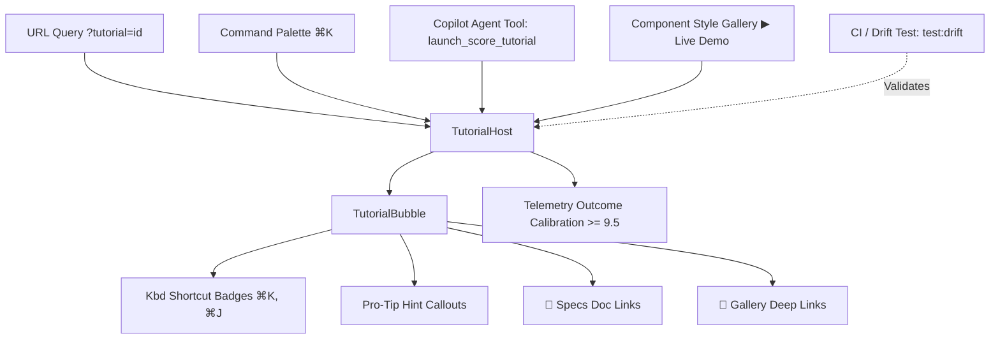

# S.C.O.R.E. Guided Walkthroughs & Interactive Demos

## 1. Executive Architecture Overview

Oddjob incorporates an on-screen, self-maintaining **Guided Walkthrough & Interactive Demo Engine** organized around the **S.C.O.R.E.** operational framework:

| Dimension | Meaning | Focus Area | Canonical Tour Target |
| :--- | :--- | :--- | :--- |
| **S** | **Scope** | Boundaries, mission objectives, budget limits, and blast radius control | Workstream & Pipeline Config (`[data-tour="scope-workstream"]`) |
| **C** | **Continuity** | Checkpoints, state persistence, rollback safety, and resume semantics | Execution Graph & Step Timeline (`[data-tour="continuity-timeline"]`) |
| **O** | **Outcome** | Verification criteria, closed-loop telemetry, and quality scoring (>= 9.5) | Outcome Calibration Node (`[data-tour="outcome-calibration"]`) |
| **R** | **Reliability** | Circuit breakers, self-healing, fallback strategies, and safety gates | Reliability Guard & Circuit Breaker (`[data-tour="reliability-guard"]`) |
| **E** | **Eulerian** | Uber H3 spatial hex indexing, telemetry streaming, and signal intelligence | Spatial H3 Telemetry Grid (`[data-tour="eulerian-telemetry"]`) |

---

## 2. Component Architecture

### A. Tutorial Engine (`client/src/lib/tutorial-engine.ts`)
- **Canonical Snippets**: Pre-configured modular steps mapped to discrete UI elements via `@behavior` data-tour selectors.
- **Chained Playlists (`TUTORIAL_CHAINS` / `CANONICAL_CHAINS`)**: Multi-step, multi-screen guided tracks including:
  - `chain:executive-overview`: High-level briefing across all 5 S.C.O.R.E. dimensions.
  - `chain:developer-forge`: App Forge blueprint assembly and live code synthesis.
  - `chain:spatial-operator`: H3 hexagonal spatial analytics and telemetry feeds.
  - `chain:operator-flight-deck`: Live mission monitoring, cycle simulations, and rescue triage.
  - `chain:enterprise-architect`: Governance gates, formal layout proofs, and audit ledgers.
  - `chain:builder-pod-mastery`: Adaptive in-chat builder pods and instant app generation.
  - `chain:full-platform-immersion`: Complete end-to-end platform tour.
- **Closed-Loop Calibration**: Emits `oddjob:tutorial-completed` events with calibrated scores upon tour completion.

### B. Tutorial Host & Bubble (`client/src/components/ui/TutorialBubble.tsx` & `TutorialHost.tsx`)
- **Responsive Viewport Positioning**: Computes optimal placement (`top`, `bottom`, `left`, `right`) with auto-flipping and screen boundary clamping.
- **URL Auto-Launcher**: Inspects `?tutorial=<id>` on mount, starts the tutorial, and cleanly purges the query string from the browser history via `history.replaceState`.
- **Keyboard Shortcuts**: Displays interactive `<kbd>` badges (e.g. `⌘K`, `⌘J`) indicating accelerators.
- **Actionable Hints**: Styled callout boxes offering pro-tips for interacting with the targeted feature.
- **Deep-Links**: Direct links to technical specifications (`docSlug`) and the Component Style Gallery (`componentId`).

### C. Command Palette Integration (`CommandPalette.tsx`)
- Registered under a dedicated `<CommandGroup heading="Guided Walkthroughs & Demos">`.
- Triggered instantly via `⌘K` or `Ctrl+K`.

### D. Component Style Gallery Integration (`ComponentStyleGallery.tsx`)
- Dynamic detection of matching tutorial snippets for every indexed component.
- Renders an interactive **"Live Demo" badge** in tags and a **"▶ Live Demo" button** in the card action footer.

### E. Copilot Assistant Tool (`discovery.ts` & `AgentChatSheet.tsx`)
- Tool: `launch_score_tutorial({ trackId, reason })` registered in `DISCOVERY_TOOLS` with `idempotency: "read-safe"`.
- Rich Payload: Surface rendered in chat as an interactive invitation card with a one-click **"Start Walkthrough"** button.

---

## 3. Self-Maintenance & Drift Prevention

To ensure guided walkthroughs never silently degrade or reference stale DOM selectors as the frontend evolves, three automated verification gates are enforced:

### 1. Dynamic Component Indexer Enrichment
- `server/domain/admin/infrastructure/ui-component-indexer.service.ts` scans components and associates matching tutorial snippets with indexed blueprints.

### 2. CI Drift Gate (`npm run test:drift`)
- Test file: `client/src/lib/tutorial-drift.test.ts`.
- Validates:
  1. Target source file existence on disk.
  2. Physical presence of `data-tour` / `@behavior` attributes in JSX.
  3. Non-empty CSS selector strings.
  4. Sequence integrity of all chained playlist transitions.
  5. UI Component Indexer enrichment correctness.
- Execution latency: **< 1.5 seconds**.

### 3. Automated Headed Demo Runner
- PowerShell script: `scripts/demo-score-tutorial.ps1`.
- Drives a real Chromium browser session through the tutorial flow with automated screenshot capture.
