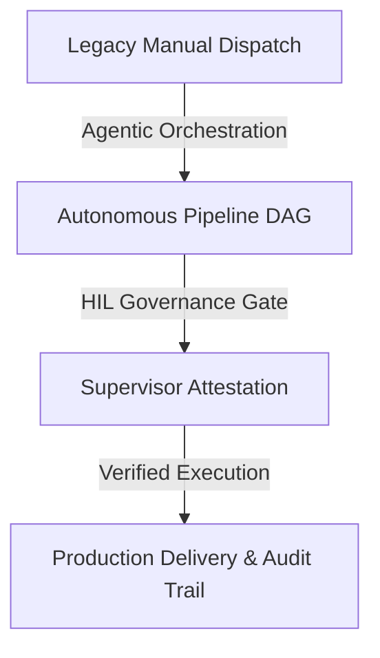

# Business Case & ROI Justification

**Project / Initiative:** `{{initiative_name}}`  
**Sponsor:** `{{executive_sponsor}}` (`{{sponsor_title}}`)  
**Author / Lead Architect:** `{{author_name}}`  
**Date:** `{{document_date}}`  
**Target Review Body:** `{{governance_committee_name}}`  

---

## 1. Executive Summary & Strategic Rationale
### 1.1 The Strategic Problem
{{#problem_statement}}
Describe the operational friction, legacy bottleneck, or competitive threat currently facing the organization.
{{/problem_statement}}

### 1.2 Proposed Solution & Target State
{{#proposed_solution}}
Summarize the target operating model, core architectural change, and key capability unlocked by this initiative.
{{/proposed_solution}}

---

## 2. Options Appraisal
| Option | Description | CapEx / OpEx | Time to Value | Strategic Fit | Risk Rating | Recommendation |
|:---|:---|:---:|:---:|:---:|:---:|:---:|
| **Option 1: Do Nothing** | Maintain legacy status quo with manual workarounds. | $0 / High OpEx | None | Low | High | Rejected |
| **Option 2: Point Solution** | License third-party SaaS tool for single workflow. | Moderate | 2 months | Medium | Medium | Rejected |
| **Option 3: Enterprise Platform (Recommended)** | Deploy governed Oddjob agentic control plane & pipelines. | Target Investment | 6 weeks | High | Low | **Recommended** |

---

## 3. Financial Appraisal & ROI Model
### 3.1 3-Year Total Cost of Ownership (TCO) vs. Net Benefit
| Financial Metric | Year 1 | Year 2 | Year 3 | Total / Cumulative |
|:---|:---:|:---:|:---:|:---:|
| **Implementation / CapEx** | `{{y1_capex}}` | $0 | $0 | `{{total_capex}}` |
| **Operational Costs / Run** | `{{y1_opex}}` | `{{y2_opex}}` | `{{y3_opex}}` | `{{total_opex}}` |
| **Labor & Efficiency Savings** | `{{y1_savings}}` | `{{y2_savings}}` | `{{y3_savings}}` | `{{total_savings}}` |
| **Net Cash Flow** | `{{y1_net}}` | `{{y2_net}}` | `{{y3_net}}` | `{{total_net}}` |

### 3.2 Investment Metrics
- **Net Present Value (NPV @ 8% discount):** `{{npv_value}}`
- **Internal Rate of Return (IRR):** `{{irr_percentage}}%`
- **Payback Period:** `{{payback_months}}` Months
- **Return on Investment (ROI):** `{{roi_percentage}}%` over 36 months

---

## 4. Operational & Organizational Impact
### 4.1 Target Operating Model (TOM)

### 4.2 Stakeholder Impact Assessment
| Stakeholder Group | Current Pain Point | Target State Benefit | Change Effort |
|:---|:---|:---|:---:|
| Engineering / DevOps | Manual ticket triage & alert fatigue | Automated mitigation pipelines | Medium |
| Operations & Product | Slow cycle turnaround (weeks) | Self-service Instant App forging | Low |
| Compliance & Audit | Fragmented logs & manual attestations | W3C Distributed Trace & zero-downtime DB | Low |

---

## 5. Risk, Governance & Compliance Posture
| Risk Category | Inherent Risk | Residual Risk | Governance Control / Mitigation |
|:---|:---:|:---:|:---|
| **Security & RBAC** | High | Low | Role-based spatial boundaries + tenant isolation |
| **Model Hallucination** | Medium | Low | Deterministic GQE attestation + formal verification nodes |
| **Vendor Dependency** | Medium | Low | Pluggable multi-model MoE router with fallback |

---

## 6. Implementation Roadmap & OKRs
### 6.1 Phased Execution
- **Phase 1 (Weeks 1-3):** Foundation deployment & Knowledge Graph ingestion.
- **Phase 2 (Weeks 4-6):** Pipeline DAG automation & HIL governance integration.
- **Phase 3 (Weeks 7-8):** Production cutover & operator enablement.

### 6.2 Target OKR Scorecard
- **Objective:** Radically accelerate operational cycle velocity while maintaining zero-defect compliance.
  - *KR 1:* Reduce cycle cycle-time from 14 days to under 48 hours.
  - *KR 2:* Achieve 100% W3C forensic trace coverage across all autonomous agent actions.
  - *KR 3:* Attain minimum 85% stakeholder satisfaction score at 90-day post-launch review.

---

## 7. Decision Request & Steering Committee Approval
**Requested Action:** Approval to allocate `{{currency_symbol}}{{budget_request}}` and proceed with Phase 1 execution.

| Approver | Role | Status | Date |
|:---|:---|:---:|:---|
| `{{cfo_or_finance_lead}}` | Chief Financial Officer | Pending | |
| `{{cto_or_tech_lead}}` | Chief Technology Officer | Pending | |
| `{{business_owner}}` | VP / Executive Sponsor | Pending | |
