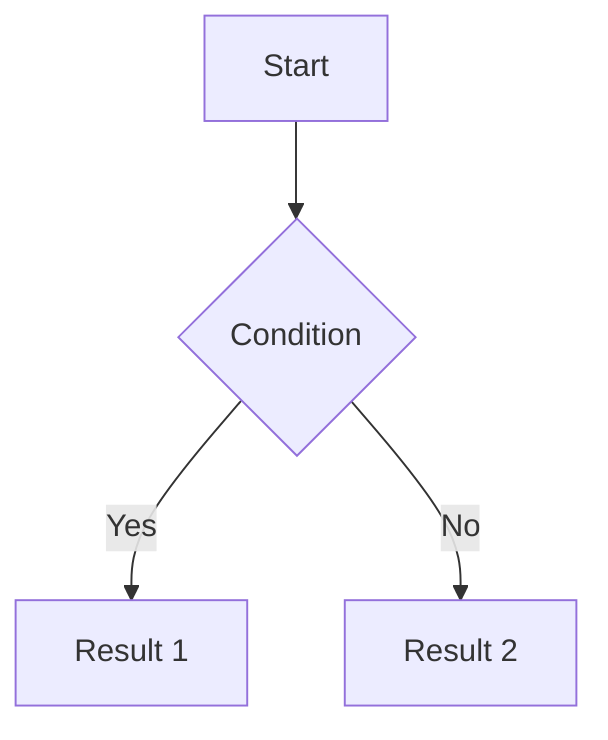

# Functional Specifications Document

**Feature/Module:** [Name]
**Author:** [Systems Analyst Name]
**Linked PRD:** [Link to Product Requirements]

## 1. System Overview
[Brief overview of the system architecture changes for this feature.]

## 2. Functional Behaviors
[Describe how the system must behave under specific conditions.]

### 2.1 Business Rules
- **BR-1**: [Rule description]
- **BR-2**: [Rule description]

### 2.2 Workflows / Process Flows
*(Insert Mermaid flowchart here)*


## 3. Data Models & Database Schema
[Details on tables, fields, types, and constraints to be added/modified.]

| Field Name | Type | Constraint | Description |
| :--- | :--- | :--- | :--- |
| [id] | [UUID] | [Primary Key] | [Unique identifier] |

## 4. API Specifications
### Endpoint: `[GET / POST] /api/v1/[resource]`
- **Description**: [What this endpoint does]
- **Request Payload**:
```json
{
  "key": "value"
}
```
- **Response Payload**:
```json
{
  "success": true
}
```

## 5. Error Handling & Edge Cases
- **Scenario 1**: [Describe scenario] -> **System Action**: [Describe how system handles it gracefully]
