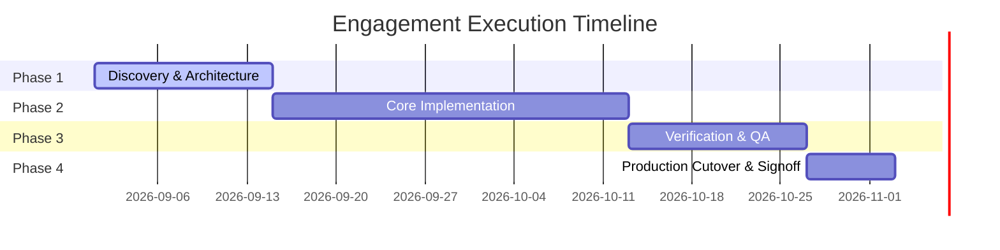

# Statement of Work (SOW)

**Document Reference:** `SOW-{{project_code}}-{{version}}`  
**Effective Date:** `{{effective_date}}`  
**Client:** `{{client_name}}` (`{{client_legal_entity}}`)  
**Service Provider:** `{{provider_name}}` (`{{provider_legal_entity}}`)  
**Project Name:** `{{project_name}}`  
**Master Services Agreement Reference:** `{{msa_reference_or_date}}`  

---

## 1. Executive Summary & Strategic Objectives
### 1.1 Business Context
{{#business_context}}
Describe the business driver, current operational challenge, and strategic rationale behind this engagement.
{{/business_context}}

### 1.2 Engagement Objectives
The primary objectives of this engagement are:
1. **Objective 1:** Deliver `{{primary_outcome}}` within `{{target_duration_weeks}}` weeks of kickoff.
2. **Objective 2:** Ensure zero operational downtime for critical workflows during deployment.
3. **Objective 3:** Achieve formal acceptance against defined service level metrics and KPI thresholds.

---

## 2. Scope of Services
### 2.1 In-Scope Work Packages
| Work Package ID | Work Package Name | Description | Key Deliverable Link |
|:---|:---|:---|:---|
| `WP-01` | Discovery & Architecture Alignment | System topology mapping, security posture audit, and data contract finalization. | `DEL-01` |
| `WP-02` | Core Implementation & Integration | Execution of primary pipeline DAGs, API integrations, and database migrations. | `DEL-02` |
| `WP-03` | Verification, Testing & QA | Automated regression test suites, blast radius validation, and UAT signoff. | `DEL-03` |
| `WP-04` | Deployment & Cutover | Staged canary deployment, live telemetry verification, and operational runbook handoff. | `DEL-04` |

### 2.2 Explicit Out-of-Scope Exclusions
The following items are expressly excluded from the scope of this SOW:
- Hardware procurement, physical datacenter provisioning, or third-party license subscription fees.
- Remediation of pre-existing legacy defects outside the defined target repository subgraph.
- End-user change management and training programs beyond the designated administrator knowledge transfer session.

---

## 3. Deliverables & Acceptance Criteria
### 3.1 Deliverables Schedule
| Deliverable ID | Deliverable Title | Format / Artifact | Acceptance Threshold | Due Milestone |
|:---|:---|:---|:---|:---|
| `DEL-01` | Architecture Blueprint & Threat Model | PDF + Interactive AST | Approved by Client Security Lead | Milestone 1 |
| `DEL-02` | Production Service Implementation | Git PR + Container Artifact | Passes 100% CI/CD unit & property tests | Milestone 2 |
| `DEL-03` | Verification & Load Test Report | Markdown + CSV Telemetry | `P(Success) >= 0.999` under 10k RPS load | Milestone 3 |
| `DEL-04` | Standard Operating Procedure (SOP) | Markdown in Knowledge Base | Signed off by Operations Lead | Milestone 4 |

### 3.2 Formal Acceptance Protocol
1. **Submission:** Provider shall formally notify Client Project Lead upon deliverable completion.
2. **Review Period:** Client shall have five (5) business days to review and either approve or provide detailed written feedback citing specific non-conformance against acceptance thresholds.
3. **Deemed Acceptance:** If no written feedback or rejection is received within five (5) business days, the deliverable shall be deemed accepted.

---

## 4. Milestones, Timeline & Critical Path
### 4.1 Milestone Schedule

### 4.2 Key Dependencies
- Client provision of staging API credentials and sandbox access within two (2) business days of kickoff.
- Timely feedback from designated Client review squad per RACI matrix.

---

## 5. Staffing, Governance & RACI Matrix
### 5.1 Staffing Roster
| Role | Assigned Personnel / Agent Persona | Organization | Allocation |
|:---|:---|:---|:---|
| Delivery Principal | `{{delivery_lead_name}}` | Provider | 50% |
| Lead Architect | `{{lead_architect_name}}` | Provider | 100% |
| Security Lead | `{{security_lead_name}}` | Client | 25% |
| Client Sponsor | `{{client_sponsor_name}}` | Client | Escalation Only |

### 5.2 RACI Matrix
| Activity / Deliverable | Delivery Principal | Lead Architect | Client Sponsor | Client Security |
|:---|:---:|:---:|:---:|:---:|
| Architecture Blueprint (`DEL-01`) | **A** | **R** | **I** | **C** |
| Core Service Implementation (`DEL-02`) | **A** | **R** | **I** | **I** |
| Blast Radius & Security Signoff | **C** | **R** | **I** | **A** |
| Final Acceptance & Billing Signoff | **R** | **I** | **A** | **I** |

*(R = Responsible, A = Accountable, C = Consulted, I = Informed)*

---

## 6. Commercials, Pricing & Payment Terms
### 6.1 Commercial Structure
- **Engagement Model:** `{{pricing_model}}` (Fixed Fee / Time & Materials / Blended Milestone)
- **Total Contract Value (TCV):** `{{currency_symbol}}{{total_contract_value}}` (Exclusive of applicable taxes)

### 6.2 Payment Milestone Schedule
| Milestone | Trigger Event | Invoiced Amount | Payment Terms |
|:---|:---|:---|:---|
| **M1: Kickoff & Discovery** | Execution of SOW + Delivery of `DEL-01` | 25% (`{{m1_amount}}`) | Net 30 |
| **M2: Implementation Midpoint**| Completion of `DEL-02` in Staging Sandbox | 35% (`{{m2_amount}}`) | Net 30 |
| **M3: QA Signoff** | Delivery and verification of `DEL-03` | 25% (`{{m3_amount}}`) | Net 30 |
| **M4: Production Final** | Handoff of `DEL-04` + Production deployment | 15% (`{{m4_amount}}`) | Net 30 |

---

## 7. Assumptions & Risk Register
### 7.1 Key Assumptions
1. All client third-party upstream APIs maintain 99.9% availability during integration testing windows.
2. Production deployment windows occur during scheduled maintenance periods without ad-hoc freezes.

### 7.2 Risk & Mitigation Register
| Risk ID | Risk Description | Probability | Impact | Mitigation Strategy |
|:---|:---|:---:|:---:|:---|
| `RSK-01` | Upstream schema drift during development | Medium | High | Implement automated contract tests with CI drift alerts. |
| `RSK-02` | Delays in client security credential issuance | Low | High | Pre-kickoff access verification checklist required before T0. |

---

## 8. Change Control, SLAs & Signatures
### 8.1 Change Control Protocol
Any change to scope, timeline, deliverables, or commercials requires an executed written **Change Order (CO)** signed by authorized representatives of both parties prior to work commencement.

### 8.2 Authorized Signatures
By signing below, the parties agree to the terms, conditions, and deliverable commitments set forth in this Statement of Work.

| For Client: `{{client_name}}` | For Service Provider: `{{provider_name}}` |
|:---|:---|
| **Signature:** ________________________________ | **Signature:** ________________________________ |
| **Name:** `{{client_signatory_name}}` | **Name:** `{{provider_signatory_name}}` |
| **Title:** `{{client_signatory_title}}` | **Title:** `{{provider_signatory_title}}` |
| **Date:** `{{client_sign_date}}` | **Date:** `{{provider_sign_date}}` |
