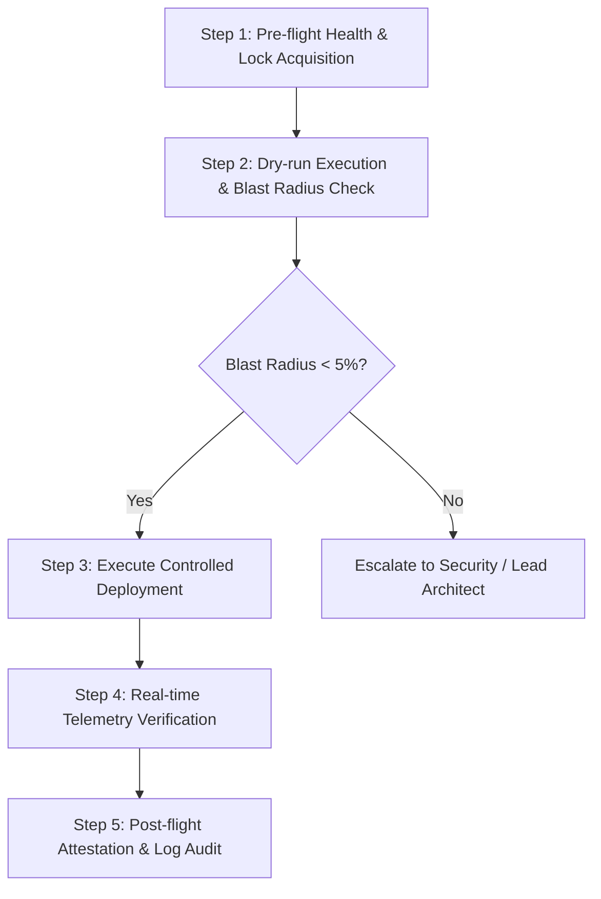

# Standard Operating Procedure (SOP)

**SOP Identifier:** `SOP-{{department_code}}-{{sop_number}}`  
**Title:** `{{sop_title}}`  
**Version:** `{{version_number}}`  
**Effective Date:** `{{effective_date}}`  
**Review Cadence:** `{{review_cadence}}` (Quarterly / Semi-Annual / Annual)  
**Process Owner:** `{{process_owner_role}}`  
**Target Audience:** `{{target_operator_roles}}`  

---

## 1. Purpose, Scope & Applicable Systems
### 1.1 Purpose
This Standard Operating Procedure establishes the mandatory protocol for executing `{{procedure_name}}` to ensure operational safety, compliance, and deterministic execution quality.

### 1.2 Scope
- **Applies To:** All operators, engineers, and automated agents performing `{{procedure_name}}`.
- **Governed Systems:** `{{affected_systems_or_subgraphs}}`.
- **Classification:** `{{data_classification_level}}` (Internal / Confidential / Restricted).

---

## 2. Prerequisites, Credentials & Environmental Setup
Before beginning execution, verify that all prerequisites are satisfied:

| Prerequisite ID | Item / Credential | Verification Method | Mandatory? |
|:---|:---|:---|:---:|
| `REQ-01` | Workspace Operator RBAC Role | Verified in User Settings | Yes |
| `REQ-02` | Staging Sandbox Health State | Health check endpoint returns `HTTP 200` | Yes |
| `REQ-03` | Active Incident / Ticket Reference | Valid JIRA / ServiceNow ticket id | Yes |
| `REQ-04` | Database Backup Timestamp | Latest snapshot `< 60 minutes` old | Yes |

---

## 3. Step-by-Step Procedure

### Step 1: Pre-flight Verification & Distributed Lock Acquisition
1. Open the designated Oddjob Crew Room or Operations Pipeline Dashboard.
2. Verify system consensus telemetry shows `safeTransitionScore >= 0.85`.
3. Acquire the execution mutex lock for target subgraph `{{target_subgraph_id}}`.
   - *Expected Outcome:* Lock confirmation banner displays with 15-minute lease timer.

### Step 2: Dry-Run & Blast Radius Simulation
1. Trigger the dry-run simulation pipeline with parameter payload `{{test_payload}}`.
2. Inspect the synthesized blast-radius metric.
   - *Pass Criteria:* Blast radius must remain `<= 5.0%` of active tenant records.
   - *Fail Criteria:* If blast radius `> 5.0%`, halt immediately and initiate HIL escalation protocol.

### Step 3: Production Execution
1. Dispatch the production pipeline execution step.
2. Monitor live SSE streaming telemetry for any unhandled exceptions or connection retries.
   - *Expected Outcome:* Step status transitions to `completed` within `{{sla_duration_seconds}}` seconds.

### Step 4: Live Telemetry Verification & Health Sweep
1. Inspect the 5-minute rolling error rate in the Telemetry Dashboard.
2. Confirm error rate is `< 0.01%` and P99 latency is `< 250ms`.
   - *Expected Outcome:* All signal indicators show Green status.

### Step 5: Post-flight Attestation & Record Archival
1. Execute supervisor sign-off attestation in the HIL Governance portal.
2. Archive the W3C trace payload and attach the run ID to ticket `{{ticket_reference}}`.
3. Release the distributed execution lock.

---

## 4. Quality Assurance, Edge Cases & Failure Recovery
### 4.1 Common Exception Scenarios
| Exception Code | Trigger Condition | Immediate Action | Escalation Target |
|:---|:---|:---|:---|
| `ERR-LOCK-TIMEOUT` | Distributed lock lease expires during step 3 | Abort step, inspect DB state | DevOps On-Call |
| `ERR-TELEMETRY-SPIKE` | P99 latency exceeds 500ms for > 2 min | Trigger automated rollback DAG | Lead Architect |
| `ERR-AUTH-EXPIRED` | Operator session expires mid-execution | Re-authenticate via SSO | Identity Admin |

### 4.2 Automated Rollback Protocol
If any failure condition is met during Steps 3 or 4:
1. Immediately click `[Rollback to Last Stable Snapshot]`.
2. Verify the rollback DAG executes to completion (`HTTP 200`).
3. Notify the incident commander via the automated Slack/PagerDuty hook.

---

## 5. Compliance, Audit Trail & Record Retention
- **Audit Logging:** Every execution step is recorded in the immutable `forensic_logs` table with SHA-256 hash chaining.
- **Retention Period:** All execution traces and attestations must be retained for a minimum of seven (7) years per SOC2 / ISO27001 policy.
- **Auditor Access:** Authorized compliance reviewers may query execution records via `/api/governance/forensic-audit`.

---

## 6. Revision History & Governance Approval
| Revision | Effective Date | Author / Role | Summary of Changes | Approved By |
|:---|:---:|:---|:---|:---|
| `v1.0.0` | `{{effective_date}}` | `{{author_role}}` | Initial baseline publication | Operations Director |
