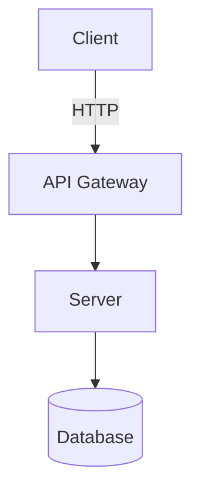

# System Architecture Specification

**System/Module Name:** [Name]
**Date:** [Date]
**Architect:** [Systems Analyst Name]

## 1. Overview & High-Level Design
[Summarize the high-level architecture pattern (Microservices, Monolith, Serverless, Agentic Pipeline, etc.)]

## 2. Component Diagram (Mermaid)

## 3. Data Flow
- [Describe step-by-step how data moves through the system.]

## 4. Key Architectural Decisions (ADR Linkages)
- Reference ADRs involved in this architecture.
