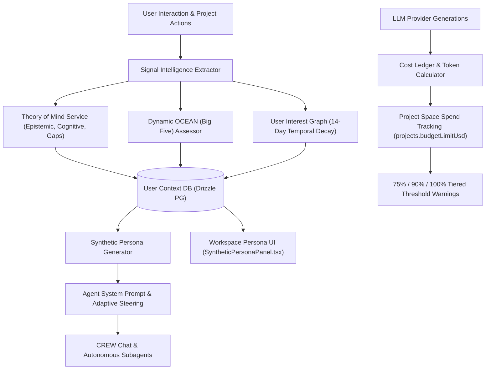

# User Context Graph, Synthetic Persona Engine & Financial Governance

## Executive Summary
This feature module provides a unified **User Context Graph**, **Synthetic Persona Engine**, **Dynamic Big Five (OCEAN) Assessment Protocol**, and **Project Financial Governance System** within Oddjob's 5-Layer AI Control Plane.

It bridges transient psychological state (Theory of Mind), durable user preferences (Dialectic User Representations), topic recency decay, and real-time financial budget enforcement into a unified graph accessible to agents and users.

---

## Key Subsystems & Architecture

---

## 1. User Interest & Topic Graph with 14-Day Recency Decay
* **Database Schema**: `shared/schema/agent/user-graph.ts` (`user_interests`, `user_project_activities`).
* **Service**: `server/domain/agents/core/user-interest-graph.service.ts`.
* **Temporal Decay Formula**:
  $$W_{\text{effective}} = W_{\text{initial}} \times 0.5^{\frac{\Delta t}{14\text{ days}}}$$
* **Capabilities**: Topics decay exponentially over a 14-day half-life if not reinforced by recent chat turns or project executions.

---

## 2. Dynamic Big Five (OCEAN) Assessment & Adaptive Communication Steering
* **Service**: `server/domain/agents/core/ocean-assessment.service.ts`.
* **Calibration Signals**: Analyzes query length, syntax structure, exploratory vs direct commands, and HIL risk tolerance.
* **Adaptive Directives**:
  * *High Conscientiousness*: Provides structured, step-by-step verification parameters.
  * *High Openness*: Offers creative architectural options and innovative alternatives.
  * *Low Neuroticism*: Executes with direct, concise status updates.

---

## 3. Synthetic User Persona Engine & UI
* **Service**: `server/domain/agents/core/synthetic-persona.service.ts`.
* **REST Endpoints**: `server/routes/user-persona.routes.ts` (`/api/user/persona`, `/api/user/persona/synthesize`, `/api/user/interests`).
* **Frontend Component**: `client/src/components/profile/SyntheticPersonaPanel.tsx`.
* **Persona Archetypes**: Assigns human-readable archetypes (e.g., *Systems Architect & Strategic Analyst*, *Exploration-Oriented Researcher*, *Data Sentinel*).

---

## 4. Project Space Financial Governance & Threshold Warnings
* **Database Schema**: `shared/schema/projects.ts` (`projects.budgetLimitUsd`).
* **Services**: `server/domain/projects/core/project.service.ts`, `server/domain/billing/cost-tracking.service.ts`.
* **Warning Escalation Tiers**:
  * **75% Budget Spent**: Medium alert toast notification.
  * **90% Budget Spent**: High-priority workspace and CREW Chat room banner.
  * **100% Budget Spent**: Critical circuit breaker (blocks paid calls and switches to zero-cost local fallbacks).
* **API Endpoints**:
  * `PATCH /api/projects/:key` (`{ "budgetLimitUsd": 25.00 }`)
  * `GET /api/projects/:key/spend`

---

## 5. Agent Capability Tools (`USER_CONTEXT_TOOLS` & `PROJECT_BUDGET_TOOLS`)

Agents and MCP consumers can query user context and project budgets via:

| Tool Name | Group | Description |
| :--- | :--- | :--- |
| `get_user_context_graph` | User Profile | Retrieves top interests, 14-day decayed weights, and recent project activities. |
| `get_synthetic_persona` | User Profile | Retrieves synthetic persona profile, archetype, focus vectors, and directives. |
| `get_user_ocean_profile` | User Profile | Retrieves Big Five OCEAN metrics and ToM consent states. |
| `get_project_spend` | Project Budget | Retrieves spend to date, budget limit, remaining USD, and cycle counts for a project. |
| `set_project_budget_cap` | Project Budget | Sets or updates the financial budget cap (USD) for a project space. |

---

## 6. CREW Chat Latency & Response Optimizations
* **JSON Unwrapping**: Automatically unwraps `{ "answer": "..." }` responses into clean prose.
* **Fast Failover**: Enforces a 15-second generation deadline for CREW chat rounds and 1.5s Ollama timeout to eliminate stalls.
